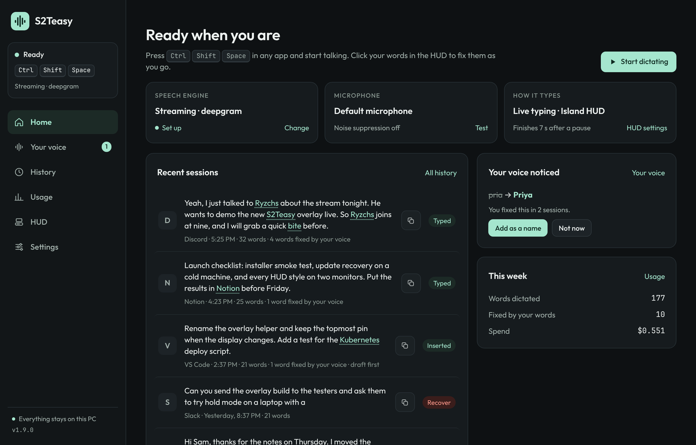
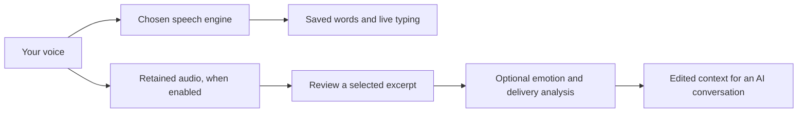
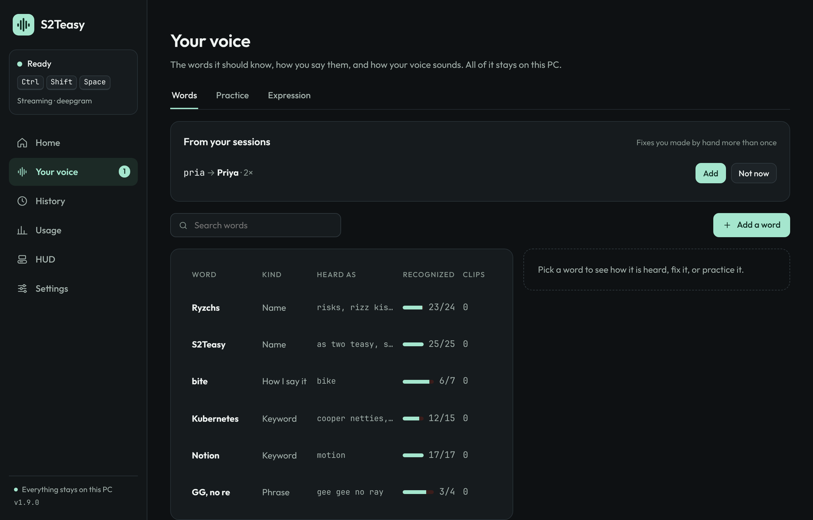
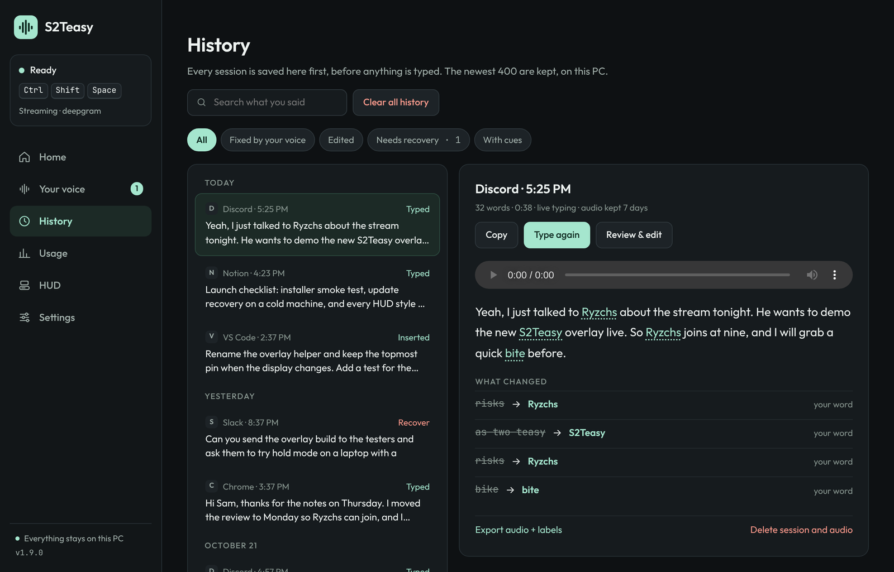
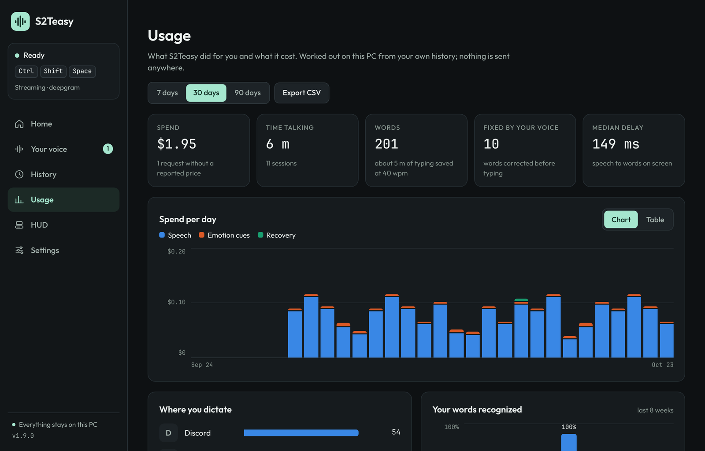
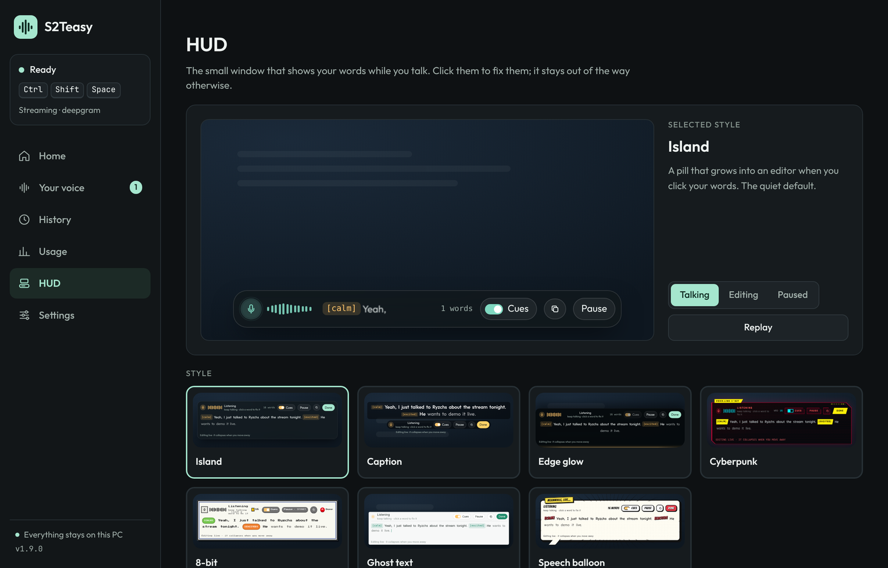
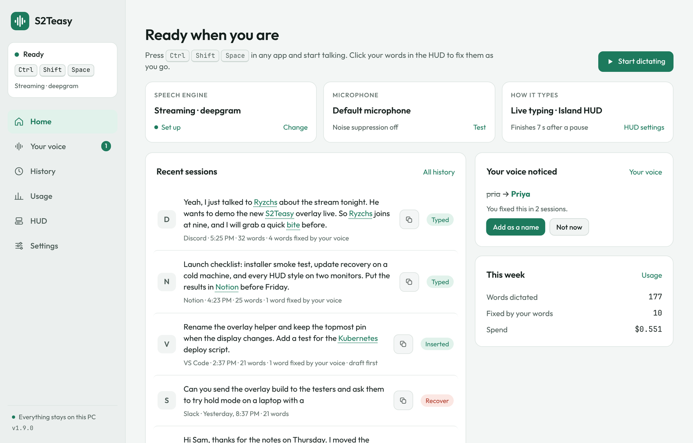
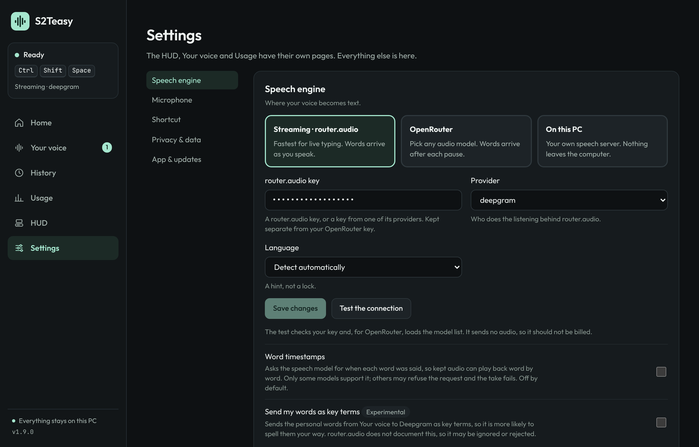
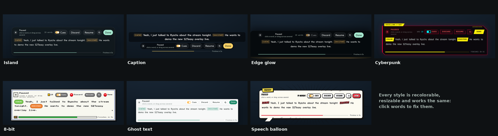
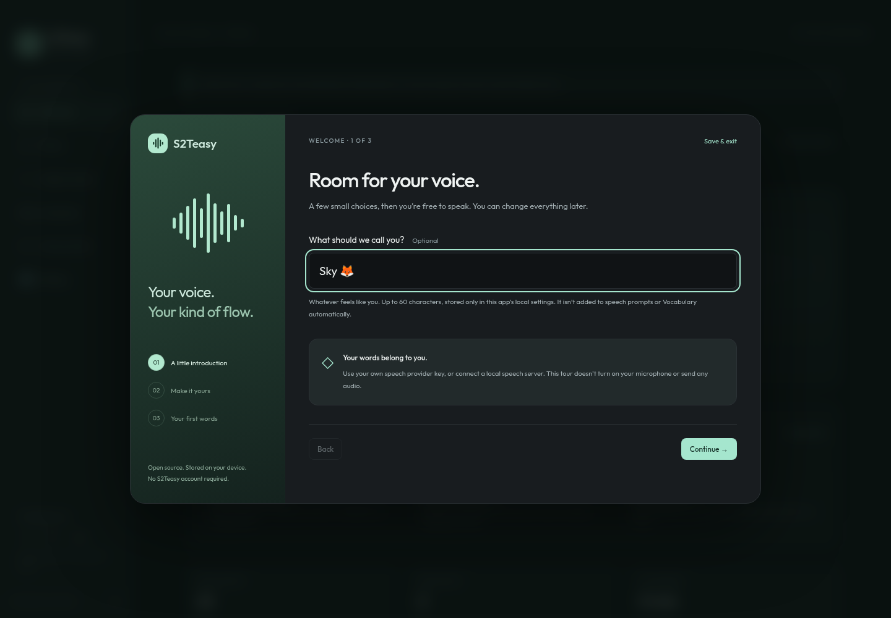

<div align="center">


# S2Teasy

**Say it. Keep the thought.**

An open source Windows dictation app with live text, recoverable sessions, and a vocabulary you control.



[](https://github.com/HighRyzchs/S2TEasy/actions/workflows/build-windows.yml)
[](https://github.com/HighRyzchs/S2TEasy/actions/workflows/pages.yml)
[](LICENSE)
[](https://ko-fi.com/rozniman)

[Project website](https://highryzchs.github.io/S2TEasy/) · [Interactive HUD demo](https://highryzchs.github.io/S2TEasy/overlay-demo/) · [Desktop workflow](docs/OUTPUT_WORKSPACE.md) · [Concepts & architecture](docs/CONCEPTS.md) · [Getting started](#getting-started) · [Development](#development) · [Privacy](docs/PRIVACY.md) · [Contributing](CONTRIBUTING.md) · [Roadmap](docs/ROADMAP.md)

**New in v1.9.0: your words, fixed before they land.** S2Teasy learns how you are misheard ("as two teasy" → S2Teasy) and fixes it while you talk. One HUD replaces two: the shortcut starts and pauses, you click a word to fix it, and a small pill asks whether to remember it. Seven HUD styles, and a redesigned app with Home, Your voice, History, Usage, HUD and Settings. [Release notes →](docs/RELEASE_NOTES.md) · [Update recovery →](docs/UPDATE_TROUBLESHOOTING.md)



</div>

> **Development build.** Automated tests and browser checks cover the development workflow. Windows microphone capture, global hotkeys, native focus/paste, and packaged installers still need a Windows release smoke test. Cloud transcription requires your own provider account; model quality and availability vary.

## What it does

- **Dictation into Windows apps.** A global shortcut starts, pauses and resumes. Words are typed live as each phrase settles, or all at once when you finish (draft first). A paused session finishes by itself after a delay you choose.
- **Your words, learned.** Fix a word in the HUD and S2Teasy offers to remember it as a name or as the way you say it. Every way a word gets misheard is kept, including several heard words for one meant word, and applied the next time you speak. A word that might still be the start of a learned phrase waits a moment before it is typed, so names are never typed half-fixed.
- **One HUD you can edit.** Click your words while you keep talking, or drag across several. Already-typed text is replaced in place only when nothing else touched the app since S2Teasy typed it; otherwise the fix stays in History and your text is left alone. Copy, a speech-cue switch and a click-through window.
- **Seven HUD styles.** Island, Caption, Edge glow, Cyberpunk, 8-bit, Ghost text and Speech balloon, each recolorable and resizable, in nine screen positions. [Try them in the browser →](https://highryzchs.github.io/S2TEasy/overlay-demo/)
- **Recoverable sessions.** Finalized text is saved before it is typed. Temporary local audio enables retry after connection or paste failures, and History plays it back.
- **Your choice of engine.** router.audio streaming, OpenRouter audio-input models, or an already-running local speech server.
- **Speech cues (optional).** Emotion and delivery tags such as `[excited]` or `[laughs]` written into copied or typed text, before the words, after them or as a context note. Off by default; one audio-model analysis per session when on, billed by your provider.
- **Usage you can read.** A local analytics page: spend by purpose, time, words, fixes, words per app, how often your own words come out right, and per-model latency and failures. Nothing is sent anywhere.

## Screens

Sample data, real app. Regenerate these with `npm run screenshots`.

| | |
| --- | --- |
|  |  |
| **Your voice.** Words, practice and speech cues. | **History.** What you said, what was fixed, audio playback. |
|  |  |
| **Usage.** Local analytics, unknown prices kept visible. | **HUD.** Live preview, styles, behavior and position. |
|  |  |
| **Light theme.** Dark, light or follow Windows. | **Settings.** One page, plain explanations. |



## Getting started

Windows x64 is the native dictation target. Build an executable on Windows using the instructions below, or download a development build from [Build Windows EXE](https://github.com/HighRyzchs/S2TEasy/actions/workflows/build-windows.yml): select a successful run and download the **S2Teasy-windows** artifact. GitHub requires sign-in to download workflow artifacts. These development executables still need the release smoke test; no stable release is claimed.

1. Open **Settings → Speech engine** and choose an engine.
2. **Streaming:** enter a router.audio or supported provider key. **OpenRouter:** enter your OpenRouter key, test it, load the audio-compatible model list, and select a model slug. **Local:** configure the loopback transcription endpoint and model served by your local server.
3. In **Settings → Dictation**, test your microphone and choose your shortcut. The default is `Ctrl + Shift + Space`.
4. Focus a text field and use the shortcut. Press it again to finish (or release it in hold mode). While finishing, press again to cancel processing and dismiss the HUD; saved checkpoints remain in History.
5. Review the transcript in **History**. If typing or transcription failed, saved text remains available. Retained audio can be recovered using OpenRouter or Local speech, or exported.

OpenRouter and streaming provider keys are **separate**. An OpenRouter key is not silently sent to router.audio. A key test verifies authentication, not whether a particular audio model can transcribe your voice.

OpenRouter operation selection defaults to **Auto**, using the model’s advertised output modality. Dedicated speech models (including `qwen/qwen3-asr-1.7b` and `x-ai/grok-stt-1.0`) use `/audio/transcriptions`; audio chat models use `/chat/completions`. **Settings → Speech engine → API operation** can override this for a newly introduced slug. The model list explicitly requests both text and transcription output; OpenRouter’s default text-only catalogue omits ASR models. No model is silently substituted on failure.

### Local speech

S2Teasy connects to an **OpenAI-compatible multipart transcription server** running on your own computer. For example, [Speaches](https://github.com/speaches-ai/speaches) can serve faster-whisper models. Follow that project's installation and model download instructions first.

Set the full endpoint (default `http://127.0.0.1:8000/v1/audio/transcriptions`) and the exact model ID installed on your server. S2Teasy sends WAV clips, `model`, an optional `language`, and vocabulary hints in `prompt`. Only loopback HTTP/HTTPS endpoints are accepted. Cloud keys are not attached to local requests. Local servers requiring authentication are not supported in this version.

This is an adapter, not a bundled model installer. A text LLM such as an ordinary Ollama chat model is not itself a speech recognizer. No local acoustic model has been downloaded or validated in this cloud setup.

### Recovery and privacy defaults

Finalized transcripts are stored locally during recording. Temporary recovery audio is **on by default**, with a visible control in **Settings → Privacy & data**. Audio is deleted after successful insertion unless successful-take retention is enabled. Failed or interrupted audio expires after seven days by default; choose 1–30 days. Expiry runs at startup and hourly while idle. If the app is closed, expired audio is removed the next time it opens.

Successful-take retention for pronunciation examples is **off by default**. Turn off temporary recovery audio too if you want no persistent audio. With both controls off, a failure before the first finalized phrase can leave no recoverable speech. Cancellation stops capture but preserves any already-saved data until deletion or expiry.

History retains the newest 400 sessions. Older app-managed sessions and their audio are removed. Deleting a session deletes its app-managed retained audio. Exports are separate files you manage yourself. Audio and transcripts are not encrypted by the app; use OS disk encryption if needed. API keys require OS credential encryption; insecure plaintext fallback is refused. See [Privacy](docs/PRIVACY.md).

## A comfortable first minute

On first launch, a three-step welcome tour lets you choose an optional name/nickname, preview your appearance and HUD, and review audio recovery before learning the recording shortcut. You can save and exit at any step. Your name stays in local settings; it is not automatically added to provider prompts or Vocabulary. Existing speech settings and History are preserved.

Change or clear your name and replay the tour in **Settings → App & updates**. Home shows whether your engine, microphone and typing are set up and links to each setting; a configured engine is not presented as a verified connection until you test it. The tour itself requests no microphone access and makes no paid speech calls.



## Review, customize, and track usage

- **HUD:** Click your words to fix them while talking, pause to edit at leisure, copy at any time. The HUD screen sets the style, color, size, one line or full text while talking, live or draft-first typing, the finish delay, nine anchors and pixel offsets.
- **Corrections:** History → Review & correct suggests word/phrase replacements after saving. Choose which to remember in Your voice, or start a practice take with the intended word filled in. Saving edits changes local History; copy corrections into an already-filled external app yourself.
- **Playback:** Retained audio plays locally. Provider word timestamps enable word highlighting, seeking, and explicitly saving a labeled word clip to Voice practice. Enable the optional word-timing request for compatible STT models; untimed/older takes retain ordinary playback. This collects labeled examples and applies vocabulary rules; acoustic fine-tuning is not implemented.
- **Usage:** 7/30/90-day charts split by purpose, words, fixes, words per app, recognition of your own words, model breakdowns, and CSV export. Only provider-reported costs are counted. Missing costs remain unknown; this is not your provider invoice. Metrics start with this version and stay in a separate local log, without transcript text or audio.
- **Speech tail:** Stop captures another 600 ms by default (configurable 0–1500 ms), flushes the capture worklet, and allows short trailing speech. Cancel still releases capture immediately. Unfinalized stream text remains available for review if the provider never commits it.

For recurring `findstr` terminals after an older update, see [update troubleshooting](docs/UPDATE_TROUBLESHOOTING.md).

### Test the updater

If **1.5.1 closes but stays on the old version**, quit from the tray and run the [current win-x64 installer](https://github.com/HighRyzchs/S2TEasy/releases/latest) file directly for recovery. Settings/history stay in place. Version 1.7.2 adds acknowledged helper startup, installed-version verification, an in-app copyable update report and a direct-installer fallback. See [update recovery and diagnostics](docs/UPDATE_TROUBLESHOOTING.md).

Development builds **1.4.1 → 1.5.0** provide a real update test. Portable 1.4.0 has a launcher-path bug: first download and open [1.4.1](https://github.com/HighRyzchs/S2TEasy/releases/tag/v1.4.1) manually, keeping that EXE at its intended location. In that app, use Settings → Privacy & data → Check for updates, download 1.5.0, and restart. Installed 1.4.0 users who see repeating FINDSTR terminals or remain on 1.4.0 should stop the legacy helpers and manually run the [current x64 installer](https://github.com/HighRyzchs/S2TEasy/releases/latest); see [recovery steps](docs/UPDATE_TROUBLESHOOTING.md). Confirm the version and your saved settings/history after restart. See [Windows testing](docs/WINDOWS_TESTING.md). Windows update execution still needs a real desktop test; Linux checks verify discovery, downloads, hashes, and helper generation.

## Development

Use Node.js 22 LTS (the version used in CI) and npm. Node.js 24 was also used for validation in the cloud environment.

```sh
npm ci
npm test
npm run typecheck
npm run build
npm run ui             # browser interface preview; mock IPC, no native dictation
npm run dev            # Electron; Windows required for native hotkeys/paste validation
```

The browser preview includes sample history and an explicit preview notice. Keys entered there stay only in page memory and are not tested. Refresh resets preview changes. The Electron app uses the local store and actual providers.

On Windows:

```sh
npm run build:win      # portable EXE and NSIS installer in release/
```

Cloud/Linux installation needs Electron downloads to use the inherited session proxy:

```sh
ELECTRON_GET_USE_PROXY=1 npm ci
```

Keep TLS and checksum verification enabled. Use the provided CA trust. In environments where cache directories are restricted, set `ELECTRON_CACHE`, `XDG_CACHE_HOME`, and npm's cache to writable paths outside the checkout.

See [Architecture](docs/ARCHITECTURE.md) and [Windows smoke test](docs/WINDOWS_TESTING.md). Tests use mocked provider responses; passing them does not establish a paid provider's availability or accuracy.

## Pronunciation personalization

Personal words are applied to the text as it settles. Each word keeps every heard form you taught it (including multi-word forms such as "as two teasy"), matches whole words and phrases using Unicode boundaries, prefers longer matches, and never cascades replacements. In live typing, trailing words that could still become a learned phrase wait for the next phrase or the end of the session. Use distinctive heard forms: a form that is a common word changes every matching occurrence.

Names, keywords and phrases also become recognition hints for OpenRouter audio chat models and local servers. Dedicated OpenRouter ASR requests omit optional keyterms because support differs by provider. Through router.audio, Deepgram `keyterm` hints are an opt-in experimental setting, because router.audio does not document them. Hints are preferences; model compliance is not guaranteed. No acoustic adaptation or automatic fine-tuning occurs.

For pronunciation examples, open **Your voice**, enter a short target phrase, consent to saving that take, and record it. No text is inserted into another application. Review the recognition in Your voice or History, correct the intended text if necessary, and export WAV + JSON. The development build groups raw recognition results by phrase and model, showing matches and retained audio examples; this measures the recognizer, not your accent. Practice takes retain their audio even when successful-take retention is globally off, because each take has its own consent. Exported labels pair the **whole take** with the intended transcript; they are not word-aligned. Text-only historical recordings cannot recover an accent. Real adaptation requires consented audio/text pairs, an engine that supports adaptation, and evaluation on held-out recordings. See the [personal speech design](docs/PERSONAL_SPEECH_DESIGN.md) and [roadmap](docs/ROADMAP.md).

## Releases and project website

The Windows CI workflow runs tests/type checks and produces build artifacts. Pushing a `v*` tag, or running the **Release Windows** workflow by hand on `main`, builds the executables and publishes the GitHub Release for the version in `package.json`. The updater targets `HighRyzchs/S2TEasy`; automatic updates are off by default and refuse artifacts without a GitHub SHA-256 digest. Run the Windows checklist and arrange code signing before treating development builds as release-ready.

`docs/index.html` is the project website. `npm run build:site` builds it into `.site/`, including an interactive demo of the real HUD component with simulated speech: seven styles, no microphone, no uploads. The **Publish project website** workflow deploys changes under `docs/` when they reach `main`, and also supports manual deployment. GitHub Pages uses **GitHub Actions** as its source. See [Publishing](docs/PUBLISHING.md) for the website, Windows builds, and release checklist.

## Support S2Teasy

S2Teasy is free and open source, with no account and no subscription. If it saves you typing, you can [buy me a coffee on Ko-fi](https://ko-fi.com/rozniman). It helps pay for testing on real Windows machines and the speech models used to try new features. Stars, bug reports and pull requests help just as much.

## License and attribution

[MIT](LICENSE). Built on the supplied S2Teasy source snapshot. Original license and attribution are preserved. S2Teasy is an independent project and is not affiliated with Wispr Flow, OpenRouter, or speech providers.
