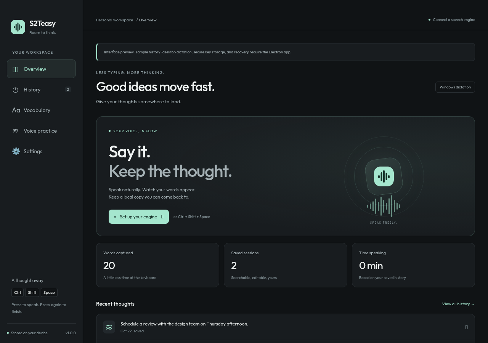

<div align="center">


# S2Teasy

**Say it. Keep the thought.**

An open source Windows dictation app with live text, recoverable sessions, and a vocabulary you control.



[](https://github.com/HighRyzchs/S2TEasy/actions/workflows/build-windows.yml)
[](https://github.com/HighRyzchs/S2TEasy/actions/workflows/pages.yml)
[](LICENSE)

[Project website](https://highryzchs.github.io/S2TEasy/) · [Getting started](#getting-started) · [Development](#development) · [Privacy](docs/PRIVACY.md) · [Contributing](CONTRIBUTING.md) · [Roadmap](docs/ROADMAP.md)

</div>

> **Development build.** Automated tests and browser checks cover the development workflow. Windows microphone capture, global hotkeys, native focus/paste, and packaged installers still need a Windows release smoke test. Cloud transcription requires your own provider account; model quality and availability vary.

## What it does

- **Dictation into Windows apps.** A configurable global shortcut, toggle or hold mode, and live phrase insertion or insertion on stop.
- **Live HUD.** Provisional text, finalized phrases, microphone activity, configurable colors/components, and top/bottom placement on the display nearest your pointer. The overlay avoids taking keyboard focus. Failures remain visible.
- **Recoverable sessions.** Finalized text is checkpointed before insertion. Temporary local audio enables retry after connection or paste failures. History distinguishes saved, interrupted, failed, and cancelled sessions.
- **Your choice of engine.** router.audio streaming, OpenRouter audio-input models, or an already-running local speech server.
- **Explicit vocabulary.** Add, disable, or remove whole-word and phrase corrections. Original recognition text is retained alongside corrected text.
- **Voice practice without typing.** Give a word/phrase its intended text, consent to local audio retention for that take, record it, and compare the recognized text. Export a WAV plus a JSON label from History. No training dataset is uploaded automatically.
- **A customizable workspace.** Dark, light, or system appearance; microphone selection and processing; searchable, editable history.

## Getting started

Windows x64 is the native dictation target. Build an executable on Windows using the instructions below, or download a development build from [Build Windows EXE](https://github.com/HighRyzchs/S2TEasy/actions/workflows/build-windows.yml): select a successful run and download the **S2Teasy-windows** artifact. GitHub requires sign-in to download workflow artifacts. These development executables still need the release smoke test; no stable release is claimed.

1. Open **Settings → Speech engine** and choose an engine.
2. **Streaming:** enter a router.audio or supported provider key. **OpenRouter:** enter your OpenRouter key, test it, load the audio-compatible model list, and select a model slug. **Local:** configure the loopback transcription endpoint and model served by your local server.
3. In **Settings → Dictation**, test your microphone and choose your shortcut. The default is `Ctrl + Shift + Space`.
4. Focus a text field and use the shortcut. Press it again to finish (or release it in hold mode).
5. Review the transcript in **History**. If typing or transcription failed, saved text remains available. Retained audio can be recovered using OpenRouter or Local speech, or exported.

OpenRouter and streaming provider keys are **separate**. An OpenRouter key is not silently sent to router.audio. A key test verifies authentication, not whether a particular audio model can transcribe your voice.

### Local speech

S2Teasy connects to an **OpenAI-compatible multipart transcription server** running on your own computer. For example, [Speaches](https://github.com/speaches-ai/speaches) can serve faster-whisper models. Follow that project's installation and model download instructions first.

Set the full endpoint (default `http://127.0.0.1:8000/v1/audio/transcriptions`) and the exact model ID installed on your server. S2Teasy sends WAV clips, `model`, an optional `language`, and vocabulary hints in `prompt`. Only loopback HTTP/HTTPS endpoints are accepted. Cloud keys are not attached to local requests. Local servers requiring authentication are not supported in this version.

This is an adapter, not a bundled model installer. A text LLM such as an ordinary Ollama chat model is not itself a speech recognizer. No local acoustic model has been downloaded or validated in this cloud setup.

### Recovery and privacy defaults

Finalized transcripts are stored locally during recording. Temporary recovery audio is **on by default**, with a visible control in **Settings → Privacy & data**. Audio is deleted after successful insertion unless successful-take retention is enabled. Failed or interrupted audio expires after seven days by default; choose 1–30 days. Expiry runs at startup and hourly while idle. If the app is closed, expired audio is removed the next time it opens.

Successful-take retention for pronunciation examples is **off by default**. Turn off temporary recovery audio too if you want no persistent audio. With both controls off, a failure before the first finalized phrase can leave no recoverable speech. Cancellation stops capture but preserves any already-saved data until deletion or expiry.

History retains the newest 400 sessions. Older app-managed sessions and their audio are removed. Deleting a session deletes its app-managed retained audio. Exports are separate files you manage yourself. Audio and transcripts are not encrypted by the app; use OS disk encryption if needed. API keys require OS credential encryption; insecure plaintext fallback is refused. See [Privacy](docs/PRIVACY.md).

## Development

Use Node.js 22 LTS (the version used in CI) and npm. Node.js 24 was also used for validation in the cloud environment.

```sh
npm ci
npm test
npm run typecheck
npm run build
npm run ui             # browser interface preview; mock IPC, no native dictation
npm run dev            # Electron; Windows required for native hotkeys/paste validation
```

The browser preview includes sample history and an explicit preview notice. Keys entered there stay only in page memory and are not tested. Refresh resets preview changes. The Electron app uses the local store and actual providers.

On Windows:

```sh
npm run build:win      # portable EXE and NSIS installer in release/
```

Cloud/Linux installation needs Electron downloads to use the inherited session proxy:

```sh
ELECTRON_GET_USE_PROXY=1 npm ci
```

Keep TLS and checksum verification enabled. Use the provided CA trust. In environments where cache directories are restricted, set `ELECTRON_CACHE`, `XDG_CACHE_HOME`, and npm's cache to writable paths outside the checkout.

See [Architecture](docs/ARCHITECTURE.md) and [Windows smoke test](docs/WINDOWS_TESTING.md). Tests use mocked provider responses; passing them does not establish a paid provider's availability or accuracy.

## Pronunciation personalization

The vocabulary is a deterministic, case-insensitive post-pass over **each finalized segment**. It matches whole words/phrases using Unicode boundaries, prefers longer matches, and never cascades replacements. Rules spanning separate finalized segments are not applied. Use distinctive phrases: a rule for a common word changes every matching occurrence in new dictations.

For OpenRouter and Local speech, enabled intended words also become prompt hints. These are preferences; model compliance is not guaranteed. Streaming provider keyword boosting is not implemented because provider contracts differ. No acoustic adaptation or automatic fine-tuning occurs.

For pronunciation examples, open **Voice practice**, enter a short target phrase, consent to saving that take, and record it. No text is inserted into another application. Review the recognition in Voice practice or History, correct the intended text if necessary, and export WAV + JSON. Practice takes retain their audio even when successful-take retention is globally off, because each take has its own consent. Exported labels pair the **whole take** with the intended transcript; they are not word-aligned. Text-only historical recordings cannot recover an accent. Real adaptation requires consented audio/text pairs, an engine that supports adaptation, and evaluation on held-out recordings. See the [roadmap](docs/ROADMAP.md).

## Releases and project website

The Windows CI workflow runs tests/type checks and produces build artifacts. Tagged releases build the executables. The updater targets `HighRyzchs/S2TEasy`; automatic updates are off by default and refuse artifacts without a GitHub SHA-256 digest. Run the Windows checklist and arrange code signing before treating development builds as release-ready.

`docs/index.html` is a standalone project website with no external dependencies. The **Publish project website** workflow deploys changes under `docs/` when they reach `main`, and also supports manual deployment. GitHub Pages uses **GitHub Actions** as its source. See [Publishing](docs/PUBLISHING.md) for the website, Windows builds, and release checklist.

## License and attribution

[MIT](LICENSE). Built on the supplied S2Teasy source snapshot. Original license and attribution are preserved. S2Teasy is an independent project and is not affiliated with Wispr Flow, OpenRouter, or speech providers.
