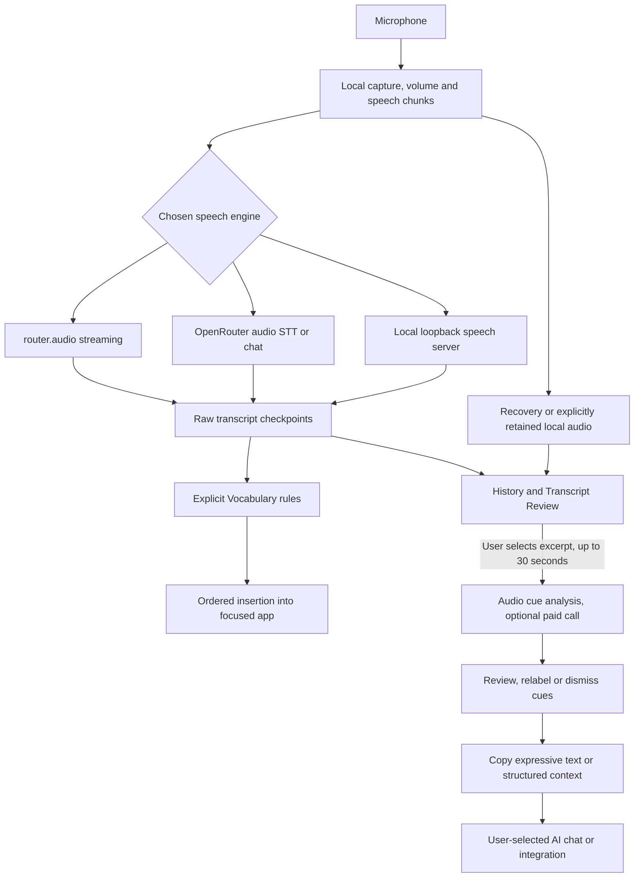
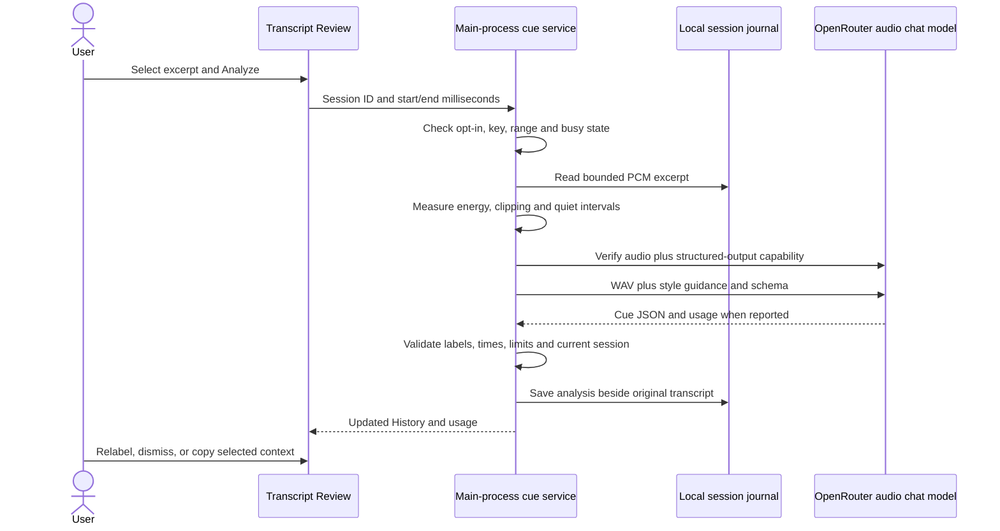
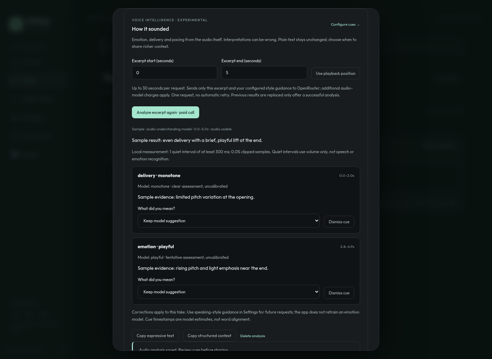

# Why S2Teasy exists, and how it works

[Start here](../README.md) · [Try speech cues](#try-emotion-and-delivery-analysis) · [Code map](#follow-the-code) · [Design details](PERSONAL_SPEECH_DESIGN.md) · [Privacy](PRIVACY.md)

S2Teasy aims to keep a spoken thought intact: get it into the app you are using, recover it when recognition fails, and let you control its spelling and presentation. An open source dictation tool should explain both what it does and what it cannot yet do.

We are solving three related problems:

| Problem | Current approach | Boundary |
| --- | --- | --- |
| Long dictation can lose words or fail before insertion | Ordered chunks, raw text checkpoints, optional recovery audio and capture-tail flushing | Real-world engine/microphone testing still matters |
| Recognizers repeatedly miss a person's names and vocabulary | Visible word/phrase rules, original-text review, labeled word clips and practice summaries | Saved examples do not automatically retrain a recognizer |
| Plain text loses vocal expression useful to an AI conversation | Opt-in audio analysis for emotional delivery, pacing, emphasis, monotone speech, laughter and sighs | Interpretations are uncertain and require user review; downstream apps must consume the context |

## The whole app in one diagram



Live typing does not wait for cue analysis. We never rewrite already pasted text just because an enrichment request returns later. Cue analysis is a separate, explicitly requested operation on retained audio. It neither needs nor invokes video generation.

## What “emotion from audio” means here

Words and vocal delivery are different evidence. “That's great” could be quiet, excited, hesitant or sarcastic. A transcript alone loses pitch movement, intensity, timing and nonverbal sounds. An audio-capable multimodal model can assess those features directly and suggest a delivery interpretation. That capability must be tested per model; an audio input flag alone does not guarantee accurate emotional understanding.

The current experimental module has two evidence paths:

1. **Local measurements:** duration, RMS energy, clipped-sample fraction and quiet intervals of at least 300 ms. These are simple PCM calculations. Quiet is not automatically a speech pause, and volume is not an emotion.
2. **Audio-model interpretation:** a bounded WAV excerpt is sent to an audio-input chat model with a strict JSON schema. It returns estimated time ranges, category, label, `tentative`/`clear` assessment and a short acoustic explanation. These assessments are not calibrated probabilities or a diagnosis of inner feelings.

Categories are independently configurable: emotion, delivery, pacing and nonverbal events. Emotion labels include calm, excited, happy, sad, frustrated, anxious, curious, playful, uncertain and neutral. Delivery includes monotone and emphasis; monotone does not imply sadness. Users can restrict emotion labels, keep only model-described clear cues, and provide a short description of their normal speaking style. Guidance is sent with each requested excerpt; it is not a learned acoustic baseline.

If the audio is poor, contains ambiguous speakers or lacks reliable evidence, the model is instructed to abstain. Silence is also checked locally. There is no forced emotion label. Model-reported timestamps are estimates, separate from the provider's word timings used for playback.

## What happens when you press Analyze



The caller sends an opaque session ID, not an arbitrary file path or a renderer-supplied audio file. Only the selected excerpt is uploaded; the transcript, display name and historical archive are not sent by this module. The key stays in the main-process network request and encrypted settings persistence. The main window is the only permitted caller of cue IPC operations.

One analysis request can run at a time. Excerpts are at most 30 seconds; the reader allocates only the selected range. Requests time out, do not automatically retry, and require a route supporting both the JSON schema and denied provider data collection. Errors do not silently change models or relax that policy. This routing preference does not replace OpenRouter/provider retention terms.

Closing Review or pressing Cancel aborts pending work; already sent requests may still be billed. Deleting the take or changing relevant settings prevents late results from recreating old History. Provider errors leave previous analysis and original words intact. Successful output is locally filtered to the chosen categories/labels. Reported costs are logged as `speech-cues`; absent costs stay unknown.

## A small context format for AI conversations

“Expressive text” appends a readable list of selected cues. “Structured context” copies versioned JSON containing `text` and an `audioContext` object with the analyzed excerpt range, model, audio quality, a caveat and cue records. Neither automatically inserts annotations into your other apps.

```json
{
  "schemaVersion": 1,
  "text": "I thought that was the plan.",
  "audioContext": {
    "analyzedRangeMs": [0, 5000],
    "model": "example/audio-model",
    "quality": "usable",
    "caveat": "Delivery interpretations are uncertain, not facts about internal feelings.",
    "cues": [
      {
        "startMs": 900,
        "endMs": 2200,
        "kind": "emotion",
        "label": "playful",
        "source": "user"
      }
    ]
  }
}
```

This is an illustrative payload, not a measurement. User labels are separate from original model labels. Model-sourced cues include an uncalibrated `assessment`; dismissed cues are omitted. The export deliberately omits free-form model explanations, reducing the amount of untrusted model prose a receiving LLM must handle. Integrations should treat all text as user data and never convert it into privileged system instructions. A chatbot can consume pasted context, but a dedicated integration/SDK should explicitly support the schema; there is no automatic connection to every chat app.

Corrections are stored per take. They do not retrain a model or establish general emotional accuracy. A user can update speaking-style guidance for future requests. Audio-based personal calibration and cross-session cue learning remain future work.

## Try emotion and delivery analysis



Interface preview with simulated results; it is not evidence of real-model accuracy.

1. Install **v1.7.0 or later**. In **Settings → Voice intelligence**, save your OpenRouter key, enable cue analysis and choose an audio chat slug. The initial candidate is `google/gemini-2.5-flash-lite`; use **Load compatible models** to check the current catalogue. This key is separate from router.audio's streaming key. Local dictation does not enable cloud cues automatically.
2. Configure emotion/delivery categories, allowed emotion labels, assessment filtering and optional speaking-style guidance. Save settings. Check the model's current **audio** pricing; text-only price examples are not audio quotes.
3. For a quick retained sample, open **Voice practice**, consent to saving a take, and record a short natural sentence in your usual voice. You can also retain successful dictation takes using the existing audio-retention setting.
4. Open that take through **History → Review**, listen back and select an excerpt up to 30 seconds in **How it sounded**. Press **Analyze excerpt · paid call**.
5. Review the result, relabel or dismiss cues, then copy expressive text or structured context into an AI chat. Inspect **Usage & spend** for the separate cue request.

Old text-only history has no vocal evidence to analyze. Audio retention remains under the existing 1–30 day policy; analysis metadata can remain with the text after audio expires. Delete the analysis or History entry to remove the app's saved cue labels. Exported or already provider-received data is separate.

## Follow the code

| Concern | Implementation | Checks |
| --- | --- | --- |
| Settings, cue schema, validation, feedback and copy format | [speech-cues.ts](../src/shared/speech-cues.ts) | [speech-cues.test.ts](../src/shared/speech-cues.test.ts) |
| Configure labels, model, key and personal guidance | [CueSettingsPanel.tsx](../src/renderer/src/CueSettingsPanel.tsx), [SettingsPanel.tsx](../src/renderer/src/SettingsPanel.tsx) | Browser and component checks |
| Select excerpts, run/cancel, relabel and copy | [SpeechCuePanel.tsx](../src/renderer/src/SpeechCuePanel.tsx), [TranscriptReview.tsx](../src/renderer/src/TranscriptReview.tsx) | [SpeechCuePanel.test.tsx](../src/renderer/src/SpeechCuePanel.test.tsx) |
| Narrow IPC bridge and main-window caller checks | [ipc.ts](../src/shared/ipc.ts), [preload/index.ts](../src/preload/index.ts), [main/index.ts](../src/main/index.ts) | Typecheck and service checks |
| Bounded session audio reads and atomic metadata | [session-journal.ts](../src/main/session-journal.ts) | [session-journal.test.ts](../src/main/session-journal.test.ts) |
| Local audio observations | [audio-observations.ts](../src/main/audio-observations.ts) | [audio-observations.test.ts](../src/main/audio-observations.test.ts) |
| Model discovery, audio chat request and accounting | [speech-cue-model.ts](../src/main/speech-cue-model.ts) | [speech-cue-model.test.ts](../src/main/speech-cue-model.test.ts) |
| Consent/busy checks, cancellation and late-result protection | [speech-cue-service.ts](../src/main/speech-cue-service.ts) | [speech-cue-service.test.ts](../src/main/speech-cue-service.test.ts) |
| Usage log, charts and CSV | [usage.ts](../src/shared/usage.ts), [usage-store.ts](../src/main/usage-store.ts), [UsagePanel.tsx](../src/renderer/src/UsagePanel.tsx) | [usage.test.ts](../src/shared/usage.test.ts), [usage-store.test.ts](../src/main/usage-store.test.ts) |
| Live audio, STT operations and external insertion | [mic.ts](../src/renderer/src/lib/mic.ts), [dictation.ts](../src/main/dictation.ts), [openrouter.ts](../src/main/openrouter.ts), [router-audio.ts](../src/main/router-audio.ts), [inject.ts](../src/main/inject.ts) | Existing recorder/controller/provider tests |
| Personal words, corrections and practice progress | [vocabulary.ts](../src/shared/vocabulary.ts), [word-example.ts](../src/main/word-example.ts), [practice-progress.ts](../src/shared/practice-progress.ts) | Vocabulary, word-example and practice-progress tests |

## How to judge whether it works

The automated suite checks contracts and failure behavior with simulated model responses. It cannot establish a provider's real emotion accuracy. This release has no built-in paid test credentials or measured emotion benchmark. Real provider availability, price, latency and interpretation quality need your account and recordings.

Test the same words with neutral, expressive, playful and monotone delivery. Include different microphones, quiet speech, background noise and multiple languages. Keep user-labeled evaluation takes separate from examples used to tune guidance. Track false cues, user rejection, abstention and timestamp error, as well as cost and latency. A useful module must be able to return no interpretation, and must never lose the underlying words.
