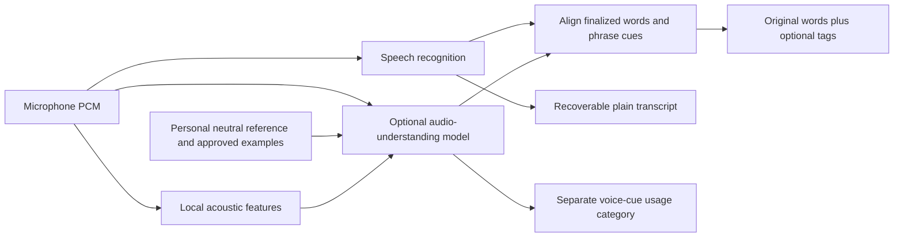

# Expressive transcription: the words and how they were said

[Try Expression & tone](https://highryzchs.github.io/S2TEasy/voice-lab/) · [Prototype walkthrough](VOICE_LAB.md) · [Existing speech-cue architecture](CONCEPTS.md)

The target is **audio → words plus delivery tags**. For example:

```text
[calm] Okay, let’s take a look.
[excited] [laughs] Wait, we actually did it!
[soft] Are you sure that’s the final result?
```

The words remain the speaker’s words. Tags describe perceived vocal expression at the relevant phrase. This is separate from correcting “shiv on” to “Siobhán”, and separate from mapping a personal hum to a text shortcut.

The user described this as the reverse direction of [ElevenLabs audio tags](https://elevenlabs.io/blog/v3-audiotags): their desired behavior is to infer descriptive tags from recorded speech rather than supply tags to generate speech. The article was inaccessible from this development environment. These are our proposed labels and output semantics, not a verified ElevenLabs compatibility claim.

## Four kinds of expression

| Category                       | Examples                                            | Evidence to consider                                                                                   |
| ------------------------------ | --------------------------------------------------- | ------------------------------------------------------------------------------------------------------ |
| Emotion expressed in the voice | angry, upset, happy, excited, calm, uncertain       | Prosodic patterns in the audio and changes relative to the speaker’s reference; not word meaning alone |
| Vocal delivery                 | whispering, monotone, animated, trembling, emphasis | Pitch contours, energy, spectral qualities, voice quality, emphasis                                    |
| Pacing                         | speaking quickly, speaking slowly, hesitant         | Word timings, words per minute, articulation, pauses and rhythm                                        |
| Nonverbal events               | laughs, sighs, gasps                                | The sound itself and its position in the recording                                                     |

A loud, fast voice can express excitement, frustration, or an ordinary speaking style. A quiet or even voice does not establish sadness. These measurements are useful evidence; no single threshold establishes an emotion. Descriptions concern perceived delivery, not a verified internal emotional state.

## The intended automatic desktop flow



When expression capture is enabled, the app should process short finalized phrases automatically. The user should not need to click Analyze on every take. Speech recognition provides words; a parallel audio-understanding path provides delivery interpretations. Local acoustic measurements and optional approved references help that interpretation. A text-only LLM cannot reconstruct pitch, laughter, or pacing from a transcript that discarded them.

For a first automatic integration, evaluate approximately 4–8 second phrase windows with limited overlapping context. Actual segmentation must respect utterances and provider limits. Use real provider word timestamps when available; otherwise attach tags at the finalized phrase boundary rather than invent word-level alignment. Cue-analysis timestamps are model estimates, not forced-alignment ground truth.

With tags enabled, briefly buffer a finalized phrase so its tags and text can be inserted together. Keep provisional words visible in the HUD. Do not retroactively rewrite an external input that the user may have edited. Save plain text before requesting cues. If the optional cue request fails or misses its deadline, commit the words without tags and preserve the untagged result for recovery. The voice-cue path must not lose final words, strand a HUD, or block cancellation. Existing microphone-tail flushing must still run at Stop.

All of that orchestration is **planned**, not connected to live desktop insertion by this prototype. There is no new desktop release in this change.

## General interpretation, then a personal reference

Users should be able to start with general audio interpretation without doing a training drill. Optional personalization would then add:

1. **An ordinary voice reference:** several short, user-approved neutral takes using the same microphone setup. Keep robust pitch, energy and pacing distributions rather than a single universal “normal voice”.
2. **Expressive examples:** “this is my excited voice”, “this sounds upset”, “I was just speaking loudly”. Keep their audio and explicit labels only with the user’s consent.
3. **Correction feedback:** retain the original model interpretation and the user’s correction. Evaluate future results against held-out examples; do not report that saving a label has retrained a model.
4. **Measured personalization:** normalize features relative to this speaker’s reference and supply selected reference examples to an audio model only with explicit upload consent. A small local classifier or genuine adaptation would require enough labeled data and validation before claiming improvement.

Microphone distance, gain control, background noise, illness, and room acoustics change the measurements. Reference profiles should identify the audio setup and allow reset or recapture. Do not treat hardware changes as an emotional change.

A reasonable starting candidate for an audio-understanding benchmark is the already configurable `google/gemini-2.5-flash-lite`, subject to current audio and structured-output availability. It is a candidate, not a demonstrated best emotional recognizer. Compare identical words delivered in different ways, multiple speaking styles, neutral speech, quiet audio, and nonverbal events. Track false tags and abstentions as well as matches. Choose the cheapest model that meets those quality checks; do not estimate audio charges using text-token rates. The browser sample makes no model call.

## What the prototype actually does

**Expression & tone** is now the first page of the voice lab. It demonstrates automatically rendered example interpretations, category switches, a clear-only filter, phrase-level tag correction/omission, and copying inline tags, plain text, or structured JSON. The “same words” scenarios keep identical text while changing sample delivery tags. All model interpretations and metrics in those scenarios are labeled examples; there is no sample audio or hidden inference request.

**Try my voice locally** records and plays real audio. It computes:

- Approximate WPM from the words the user supplies divided by total recorded time, including pauses. This is not automatic transcription or an articulation-rate estimate. The word count is language-dependent.
- An approximate median fundamental frequency and 10th–90th percentile pitch range in semitones, when sufficient periodic frames are found. Autocorrelation can fail on noise, whispering, or harmonics.
- RMS digital level and its difference from a user-selected neutral reference. This is not calibrated physical loudness in dB SPL.
- Quiet-frame fraction using an energy threshold, and an energy envelope. These are not word-aligned pauses or a trained speech detector.

The personal recording’s emotion tag is **explicitly user labeled**. The measurements do not assign angry, happy, or any other emotional label. Up to eight labeled references can be kept and replayed in the current page session. Neutral measurements, recordings and labels are memory-only and disappear on reload; nothing is uploaded or trained. Leaving the panel stops capture. Reset clears all references.

## Output and feedback contract

The prototype formatter inserts allowlisted tags at phrase boundaries and preserves the original words and whitespace. Users choose emotion, delivery, pacing, and event categories independently, or disable tags entirely. “Clear only” hides tentative example-model tags, while an explicit user correction remains visible. Clear/tentative are assessments, not calibrated probabilities.

Structured output keeps each phrase’s text and selected tags separate, with `sample-model` or `user` provenance. It makes no invented timestamp claim. A future desktop result should use genuine audio-model provenance and include actual phrase ranges where available. Inline brackets are convenient human-readable hints; receiving LLMs and speech engines may interpret them differently. They are not a universal audio-tag standard.

Feedback must remain distinct from pronunciation corrections. “I sounded frustrated here” changes a delivery label; it must never become a text replacement rule or silently rewrite the speaker’s intent.

## Code map and implementation boundaries

| Code                                                                     | Role                                                                                                                             |
| ------------------------------------------------------------------------ | -------------------------------------------------------------------------------------------------------------------------------- |
| [ExpressionLab](../src/renderer/src/ExpressionLab.tsx)                   | Working browser controls, sample scenarios, phrase feedback, local recording analysis, neutral comparison and session references |
| [Expressive transcript contract](../src/shared/expressive-transcript.ts) | Allowlisted tag rendering, plain-text preservation, filtering and structured provenance; no inference                            |
| [Local prosody measurements](../src/shared/prosody.ts)                   | Bounded acoustic analysis and reference deltas; deliberately no emotion classifier                                               |
| [Browser recorder](../src/renderer/src/VoiceLabRecorder.tsx)             | Permission, capture, volume meter, bounded recording, playback and cleanup                                                       |
| [Existing cue labels and settings](../src/shared/speech-cues.ts)         | Current desktop cue schema; the prototype’s expanded proposed labels are separate                                                |
| [Existing audio model call](../src/main/speech-cue-model.ts)             | Actual opt-in audio understanding for manually requested retained excerpts; not automatically invoked by this sample             |
| [Existing cue service](../src/main/speech-cue-service.ts)                | Audio excerpt validation, cancellation, history persistence and feedback                                                         |
| [Dictation controller](../src/main/dictation.ts)                         | Current streaming, text recovery and insertion; automatic tag orchestration is not wired here yet                                |

The next desktop work is automatic consented phrase analysis, real timing alignment, persistent optional reference profiles, feedback evaluation, and safe insertion/fallback behavior. Browser measurements and sample scenarios are not evidence that emotional recognition accuracy has been validated.
