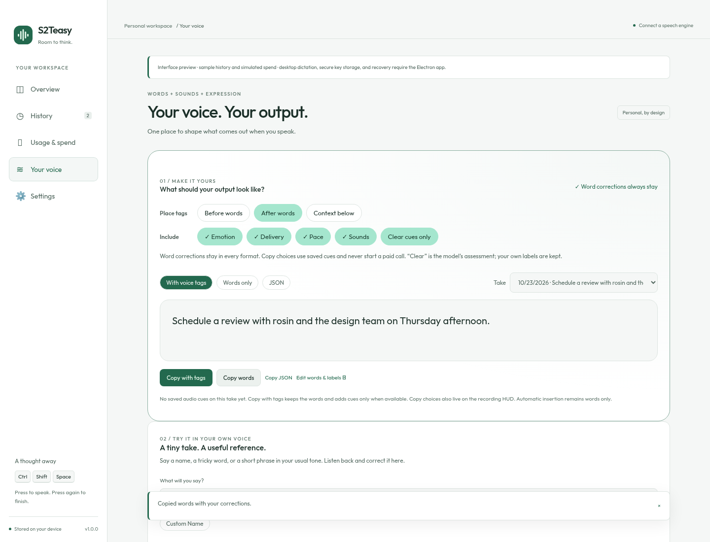
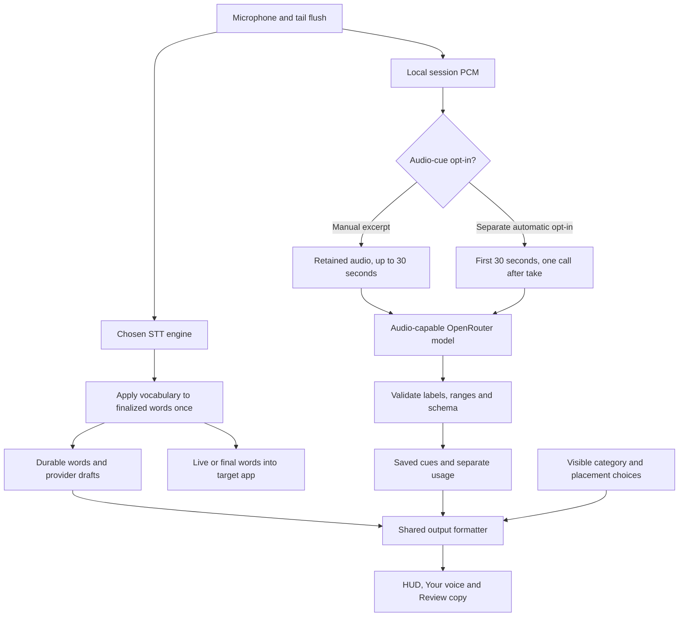

# Your voice: one workspace, explicit output

[Download the desktop app](https://github.com/HighRyzchs/S2TEasy/releases/latest) · [Try the browser design lab](https://highryzchs.github.io/S2TEasy/voice-lab/) · [Architecture](CONCEPTS.md) · [Expression theory](EXPRESSIVE_TRANSCRIPTION.md)

## The problem

People want a usable result, not a collection of unrelated switches. Word corrections personalize **what was said**. Audio cues describe **how it sounded**. Keeping both in one workspace makes the relationship visible, while keeping their data separate prevents a correction like `excited → ready` from accidentally renaming an `[excited]` tag.

Desktop v1.8.0 replaces the Vocabulary and Voice practice navigation destinations with **Your voice**. Output comes first, followed by a short-take recorder, a correction form, a searchable library of word rules and voice/expression takes, playback, and cue review. Existing rules and recordings stay in the same stores. The browser lab demonstrates additional sound cards and neutral-reference measurements; those are not a trained desktop noise recognizer or a personalized emotion model.



## Try it

1. Open **Your voice**. The output card always shows placement and category pills. Choose **Before words**, **After words**, or **Context below**; include emotion, delivery, pace, and sounds independently.
2. **Copy words** keeps your saved vocabulary corrections. **Copy with tags** adds selected saved cues. **Copy JSON** includes model/excerpt metadata and user/model provenance. If no cues are available, tagged copy gives the words without inventing a label.
3. Add a recurring word correction, or enter a practice phrase and consent to retaining that take. Record, finish, and select it in the same page. Playback uses local audio; **Review & correct** opens the detailed word editor.
4. Expand **Audio intelligence & model settings** to set the OpenRouter key and audio-understanding slug. `google/gemini-2.5-flash-lite` is a starting candidate, subject to current provider support and pricing. **Load compatible models** queries the current catalogue; it makes no inference request. The STT slug remains under **Settings → Speech engine**.
5. Enable paid speech cues if wanted. Manual analysis lets you select an excerpt of up to 30 seconds. A separate, default-off automatic option analyzes **only the first 30 seconds after each take**, with at most one additional paid audio call. Later speech remains untagged. Recording and live typing continue normally; finishing may wait for this optional call.
6. Review, relabel, or dismiss cues. User corrections retain their original model suggestion. All copy surfaces apply the same category/placement preferences.
7. On the HUD, the same pills and **Copy words / Copy with tags** buttons are visible without opening a menu. They work while recording. Copy includes saved provider drafts when present; drafts remain unconfirmed, not finalized recognition. Finish leaves the HUD available for 15 seconds, or dismiss it immediately. History remains available after dismissal.

Changing output choices or copying never starts analysis, grants upload consent, rewrites previously inserted text, or applies vocabulary a second time. Automatic insertion into other apps remains corrected words only. Output preferences may change during recording; capture/engine preferences wait until the recording finishes.

## How it works



The formatter attaches time-scoped labels around the transcript. It does **not** pretend model cue times are word alignment. Example:

```text
[excited · 1.2–3.8s] [laughter · 3.9–4.5s]
We finally got it working.
```

A long take may have only its opening analyzed. Each printed range and JSON `analyzedRangeMs` preserves that scope. Manual analysis replaces previous analysis only on success. Labels describe uncertain perceived delivery, not verified feelings. “Clear only” filters model-described tentative cues while retaining explicit user labels; it is not a calibrated confidence threshold.

Words are checkpointed before enrichment. Cue errors are stored separately as `cueError`; they do not erase text or turn successful recognition into a failed take. Cancellation aborts the request and rejects late results using the recording generation. Transient audio is removed on successful completion when training retention is off; practice takes have their own retention consent. Interrupted/cancelled recordings follow session recovery and expiry rules. An already sent request may still be billed.

## Follow the code

| Responsibility                                               | Code                                                                                                                     | Verification                                                 |
| ------------------------------------------------------------ | ------------------------------------------------------------------------------------------------------------------------ | ------------------------------------------------------------ |
| Unified desktop page                                         | [YourVoicePanel.tsx](../src/renderer/src/YourVoicePanel.tsx), [App.tsx](../src/renderer/src/App.tsx)                     | Browser navigation, word-rule and copy checks                |
| Visible output pills                                         | [OutputChoices.tsx](../src/renderer/src/OutputChoices.tsx)                                                               | Desktop/HUD browser checks at multiple scales                |
| Output normalization, filters, scope and JSON                | [output.ts](../src/shared/output.ts)                                                                                     | [output.test.ts](../src/shared/output.test.ts)               |
| HUD controls and sizing                                      | [OverlayApp.tsx](../src/renderer/src/OverlayApp.tsx), [overlay-layout.ts](../src/shared/overlay-layout.ts)               | Horizontal/vertical bounds at 80%, 100%, 140%                |
| Capture, durable words, optional enrichment and cancellation | [dictation.ts](../src/main/dictation.ts)                                                                                 | [dictation.test.ts](../src/main/dictation.test.ts)           |
| Bounded automatic audio request                              | [automatic-cues.ts](../src/main/automatic-cues.ts)                                                                       | [automatic-cues.test.ts](../src/main/automatic-cues.test.ts) |
| Manual excerpts and feedback                                 | [speech-cue-service.ts](../src/main/speech-cue-service.ts), [SpeechCuePanel.tsx](../src/renderer/src/SpeechCuePanel.tsx) | Service/model/component tests                                |
| Audio model capability, policy and billing                   | [speech-cue-model.ts](../src/main/speech-cue-model.ts)                                                                   | Mock provider contract tests                                 |
| Sender-checked presentation and authoritative copy IPC       | [index.ts](../src/main/index.ts), [preload](../src/preload/index.ts)                                                     | Typecheck and integration/browser checks                     |
| Browser design lab                                           | [VoiceWorkspace.tsx](../src/renderer/src/VoiceWorkspace.tsx)                                                             | Local sample interactions; no paid calls                     |

## Remaining work

Phrase-by-phrase enrichment during speech, inserting tagged phrases into external apps, forced alignment, personal acoustic calibration, automatic noise shortcuts, and model adaptation need further engineering and evaluation. Local pitch/WPM comparison exists in the browser design lab and is not yet fed into the desktop cue model. Existing per-take label corrections are not training. Real emotion accuracy must be evaluated with consented held-out recordings across speakers, microphones and accents; mocked API tests establish contracts, not accuracy.
