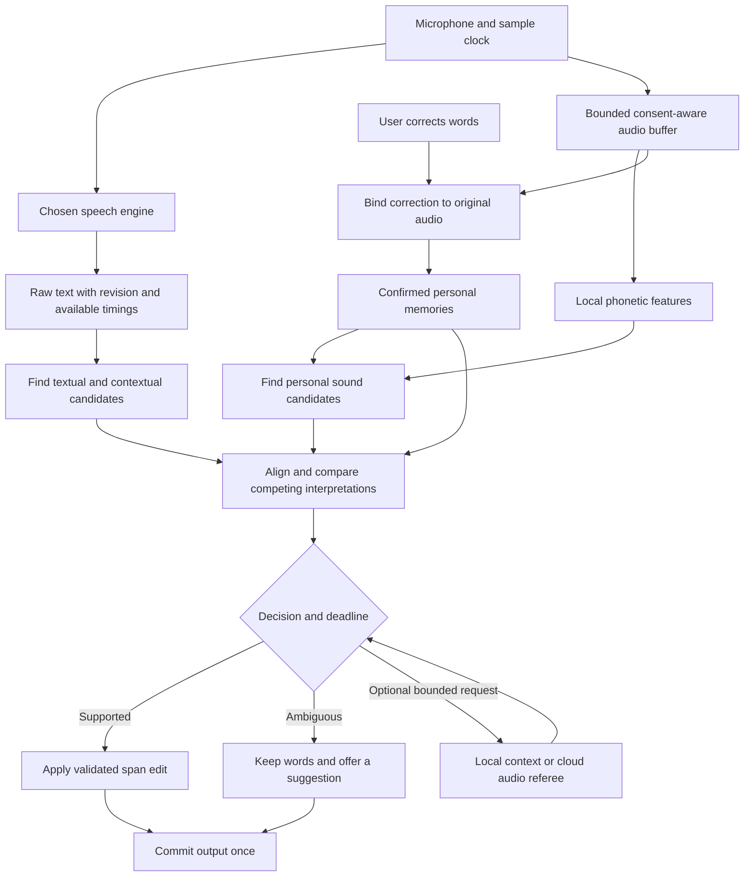
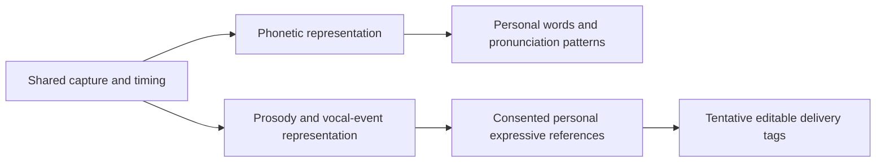

# Personal acoustic memory: correct it once, recognize it next time

**Status: proposed architecture and research plan. No acoustic learning implementation or benchmark results are claimed.** This document develops the [voice-pack proposal](VOICE_PACK.md) and is the authoritative design for its acoustic memory, decision policy, and user experience. Existing word rules, practice clips, and correction UI provide the starting point.

## The promise

A person says “gg no re.” The recognizer writes “Gigi no read.” They edit it once. With personal voice memory enabled, S2Teasy associates the actual spoken sound with **gg no re**, activates that memory immediately, and checks future speech for it. The user continues talking. Enrollment, phoneme notation, model selection, and routine drills are unnecessary.

The immediate guarantee is that the correction creates usable memory when audio and alignment are available. Recognition on every future utterance is an empirical goal, not a one-example guarantee. When the audio has expired or cannot be localized, save the written preference and explain that the sound was unavailable. Never display “learned your pronunciation” for text-only evidence.

The product interaction is small:

> Remembered how you say “gg no re.” · Undo

Behind it is a persistent, inspectable association between sound, intended text, context, and confirmed feedback. “Intent” means the user's stated output for that example; the system does not recover unspoken intentions.

## The technical contribution we are pursuing

Call the system **S2Teasy Personal Acoustic Memory (PAM)**. A voice pack is its portable data container.

PAM provides personalization outside the transcription model. It combines correction-derived acoustic examples, continuous candidate retrieval, pronunciation patterns, conservative replacement, and feedback in a single engine-independent layer. The proposed contribution is the complete measured loop and its low-effort interaction. Template matching, retrieval, contextual biasing, and adapters have substantial prior art. “First ever” and patent-novelty claims require a separate review.

LoRA changes a model's internal weights with low-rank updates. PAM initially changes an external memory and decision policy. It offers an analogous user benefit—personal adaptation—without requiring access to the recognizer's weights. A later small adapter for PAM's own phonetic encoder would belong to that encoder version, while remaining independent of the upstream STT model. It would not be a universal LoRA file.

Success means measurable fewer corrections without increased false replacements or a burdensome setup process. A pleasant UI and an architectural diagram alone do not establish novelty or accuracy.

## One audio stream, two evidence paths



The acoustic path runs alongside STT, so a recognizer spelling that resembles nothing in the dictionary can still trigger a candidate. The textual path provides an inexpensive shortlist, but it must not be the only gate into sound matching.

Retrieval proposes candidates; verification authorizes edits. A pooled embedding alone does not preserve enough ordering to safely distinguish all short words or phrases. Keep a frame sequence for fine comparison.

## The components

| Component | Responsibility | Output |
| --- | --- | --- |
| Capture clock and buffer | Preserve session generation, sample offsets, bounded PCM, and consent | Audio spans with reliable identity |
| Engine adapter | Normalize text revisions and optional provider timings | Immutable recognition snapshots |
| Correction binder | Relate an explicit edit to the original audio and text | Confirmed example or unresolved alignment |
| Phonetic extractor | Represent spoken content with timing | Versioned feature sequences and retrieval keys |
| Memory store | Keep examples, confusions, provenance, and deletions | A local voice pack |
| Candidate watcher | Search new speech against relevant memories | Bounded candidate spans |
| Acoustic verifier | Compare positives, competing words, and alignment | Evidence vector with quality indicators |
| Decision policy | Decide replace, keep, or abstain within a deadline | Validated edit or suggestion |
| Output coordinator | Preserve ordering and detect stale/already committed text | One consistent output revision |
| Learning controller | Update only eligible evidence; evaluate optional adaptation | Reversible memory revisions |

Run extraction and matching in a bounded worker or utility process. Network requests, persistence, authorization, and native insertion remain main-process responsibilities. Renderer IPC supplies opaque IDs and intended text, never arbitrary file paths or executable model instructions.

## Turning one correction into memory

1. Preserve the raw recognition snapshot before any vocabulary or grammar transformation. Record the edit's exact source span and revision.
2. Distinguish a transcription correction from a rewrite. A user choosing a nicer sentence has not supplied an acoustic label for that sentence. Default to remembering localized word/phrase corrections; ambiguous broad edits remain history edits with an optional “remember” action.
3. Map the source span to audio using provider timings where credible. Add bounded context at each edge and preserve uncertainty. If necessary, evaluate a local aligner against the original and corrected hypotheses. Alignment to supplied text is not proof that the text was spoken.
4. For reliable spans, extract features and commit the example and label atomically. For uncertain boundaries, retain a pending example only under the applicable consent; use a broader short phrase or offer optional region adjustment. Do not silently train a word from an unrelated crop.
5. Make the new memory eligible for retrieval immediately. Automatic replacement requires stronger evidence than showing a suggestion, particularly with a single example or a changed microphone.
6. Show the short confirmation. Undo revokes the new association and derived indexes without undoing the user's textual correction unless they request that separately.

A reference to recovery audio is not durable learning storage: recovery files expire. A consented example must be extracted into independently managed personal-memory storage or remain explicitly unavailable after expiry.

## Stored data and invariants

Proposed records, not current IPC contracts:

```ts
type AcousticExample = {
  id: string
  entryId: string
  sessionId: string
  segmentRevision: number
  sourceRangeUtf16: [number, number]
  sampleRange: [number, number]
  sampleRate: number
  intendedText: string
  labelSource: 'user-correction' | 'user-confirmation' | 'practice'
  relation: 'positive' | 'confirmed-alternative'
  competingEntryId?: string
  alignment: { source: 'provider' | 'local' | 'user'; quality: 'usable' | 'uncertain' }
  extractor: { id: string; version: string; featureSchema: number }
  featureRef: string
  audioRef?: string
  consentRevision: number
  createdAt: number
}
```

The pack also stores entries, pronunciation alternatives, confusion edges, device/language context when available, calibration state, and provenance for every derived prototype. A heard form can point to several intended entries. Confirmed alternatives belong to a confusion pair; rejecting one word does not establish which other word was spoken.

Use sample offsets as the audio clock and UTF-16 offsets for JavaScript text, with checks against surrogate splitting. Each proposed edit includes session generation, segment revision, exact source text, target entry ID, and evidence IDs. Validate overlap, bounds, permitted output, and revision before applying it. Preserve raw text, corrected text, and evidence separately.

Model decisions and unreviewed output are separate observation records. They cannot masquerade as confirmed examples. Synthetic variants reference their parent and count as one independent original recording.

## Matching future speech efficiently

The “watcher” is a shared streaming matcher with a bounded index, not a background model instance per word.

- Extract frame features once for each new audio block. Retain a rolling feature window covering the supported phrase lengths, with overlap so chunk boundaries do not split a match.
- Maintain retrieval keys for confirmed examples and representative prototypes. Start with a bounded linear search for small packs; introduce approximate nearest-neighbor indexing only when profiling justifies it.
- Retrieve through both acoustic and textual routes. Optional language/project context narrows candidates but must not make rare names impossible. Do not scrape window contents for context.
- Verify only the best bounded candidates using frame-level alignment, duration constraints, and competing examples. Use banded/subsequence DTW as the classical baseline; compare phonetic posteriorgrams or a learned content encoder experimentally.
- Merge duplicate detections across overlapping windows. Select compatible, non-overlapping edits for the phrase. A long phrase such as “gg no re” must compete as a unit with shorter overlapping matches.
- Bound work by audio duration and candidate count. Under load, retain raw dictation and drop or defer enrichment. Avoid an ever-growing queue.

Initial experiment budgets: 30 seconds of volatile mono 16 kHz PCM (about 0.96 MB before overhead), up to 500 entries, up to 8 representative templates per entry, top 8 candidates per verification window, and a 150 ms local enrichment deadline after a phrase settles. These are configurable engineering hypotheses, not achieved measurements. Feature memory, encoder RAM, startup cost, and worst-case latency must be measured separately. Longer phrases need an explicit supported-duration limit and fallback.

Changing extractors invalidates compatibility. Never compare vectors across versions without a tested migration. Re-extract only from retained, consented audio; otherwise keep the old extractor or request optional new examples.

## Decide using evidence, with an abstention path

For each candidate, retain distinct evidence: acoustic positive distance, distance to confirmed alternatives, alignment quality, duration fit, text/context compatibility, device shift, and independent confirmed example count.

A useful acoustic margin is `bestAlternativeDistance - positiveDistance`, since smaller distances indicate closer matches. Normalize scores for extractor and duration. A large margin alone is insufficient when every match is poor. Require absolute support as well as separation from alternatives; do not manufacture a favorable margin when no alternatives exist.

Start with an inspectable fixed policy. Calibrate thresholds on separate recordings before enabling broader automation. If later data supports a learned calibrator, preserve its inputs, version, evaluation, and rollback. Text priors and acoustic scores are not independent probabilities and should not be multiplied as if they were.

| Outcome | Behavior |
| --- | --- |
| Supported personal match | Replace only the validated span before commit |
| Supported original/alternative | Preserve recognition; record no unconfirmed training label |
| Ambiguous, conflicting, or out-of-domain | Preserve words and optionally underline the candidate |
| Invalid alignment or stale result | Discard the edit; keep existing output |

Names, numbers, short common words, and negations need particularly conservative evidence. One-shot activation is immediate; one-shot automatic replacement is selective. Truly identical pronunciations can remain ambiguous even with perfect audio.

Referees return `KEEP_HEARD`, `USE_PERSONAL`, or `UNSURE`. Use a tiny local text model only for contextual evidence; a cloud audio model can assess a bounded clip with its own explicit opt-in and cost budget. Neither response becomes a gold label without confirmation. Do not require an infallible classifier that separates “context” from “sound” cases: route from available evidence, capabilities, and budget, and abstain when the evidence disagrees. Constrain outputs and validate them locally; a grammar limits syntax, not hallucination.

## Streaming and the destination app

Provisional recognition appears immediately. Verification runs before final insertion when it can meet the bounded deadline. Phrase-prefix holdback handles a personal expression spanning several chunks, with timeout and end-of-session flush. On timeout, commit the available words and preserve later suggestions for the HUD/history.

The current app has guarded replacement of already typed text. PAM must use that existing coordinator only when its ownership and revision checks still pass; it must never independently issue backspaces. Editing elsewhere, switching targets, cancellation, or a new session invalidates pending external changes. A late model result must not overwrite a user's edit.

Copy, draft text, history, and insertion read the same accepted output revision. Cue analysis and memory matching cannot cause duplicate insertion. Faults in learning must never lose the raw transcription.

## Broader accent adaptation

Phrase memories solve named vocabulary and recurring expressions first. General accent support needs a second level: recurring phonetic correspondences learned across confirmed words and contexts.

Aggregate confirmed alignments into a language-aware pronunciation profile. Distinguish upstream recognizer confusions from actual acoustic correspondences: a misspelling alone is not evidence of how someone pronounced a phoneme. Share evidence cautiously across related words and allow multiple pronunciation variants, including code-switching. Do not infer nationality or require a named accent category.

A later personal metric or small adapter can modify PAM's phonetic representation while leaving the upstream recognizer untouched. Train from confirmed positive/contrastive examples with a frozen generic reference and a replay set to limit forgetting. Genuine homophones should not be forced apart acoustically. Evaluate on unseen words and new recording sessions; roll back if false replacements or general recognition worsen. Severe base-engine failures may require a more capable recognizer; a repair layer cannot reconstruct arbitrary missing speech from no evidence.

Raw or suitable retained training features may be required for future encoder training. Do not promise that compact retrieval vectors alone can support arbitrary future fine-tuning.

## Expression shares capture, not all invariances



Word recognition should tolerate changes in pitch, intensity, and emotion. Expression analysis needs many of those differences. Use separate feature heads or extractors and separate decision policies, sharing the audio clock, storage infrastructure, consent, and feedback mechanism.

Relative pitch, pauses, rhythm, and intensity require microphone/AGC and quality checks. A user's “that was playful” label trains an expressive association; correcting a noun provides no emotion label. Keep observed features separate from interpreted feelings. Abstain under ambiguous evidence and maintain independent switches for words and expression. Neither module may silently activate the other's cloud calls.

## User experience and data lifecycle

One optional setting explains: “Remember how I say my words on this device.” Once enabled, ordinary eligible corrections can create acoustic memory without repeated setup. Raw recording retention and cloud second opinions have separate choices. Users can keep word personalization while disabling emotion tags.

The normal flow is speak → correct → brief remembered confirmation → continue. No required drills, technical score displays, or per-word configuration. Your voice offers an optional detail card with playback when retained, intended spelling, examples, forget, undo, and suggest-only controls. Request a short contrastive example only when repeated ambiguity makes that interruption useful; allow dismissal and rate-limit requests.

Feature sequences are sensitive derived voice data and may permit partial reconstruction. Store them with OS-backed key protection where supported; the shipped app's current transcript storage does not already guarantee this. Explicitly define portable-export encryption and recovery behavior before implementation. Pack exports exclude API keys and session transcripts by default; spellings and user-approved context are inherently part of the pack. Raw examples are an additional choice.

Deleting a word removes its templates, indexes, cached matches, and derived prototypes. Deleting an example invalidates descendants and calibration based on it. Any trained adapter using deleted data must be retired and rebuilt from remaining consented examples, not claimed to have forgotten through file deletion alone. Memory records have their own retention policy disclosed separately from recovery audio. Crash recovery and migrations must preserve deletion tombstones.

## Integration with today's app

Existing files below are integration points, not claims that PAM already exists:

| Existing code | Proposed integration |
| --- | --- |
| [Vocabulary](../src/shared/vocabulary.ts) | Keep explicit rules; add a separate many-candidate acoustic memory keyed by stable entry IDs |
| [Correction extraction](../src/shared/corrections.ts) | Preserve exact source spans and revisions for a correction event |
| [Word examples](../src/main/word-example.ts) and [timings](../src/shared/word-timing.ts) | Extract consented spans with provenance and alignment uncertainty |
| [Session journal](../src/main/session-journal.ts) | Supply bounded sample ranges, cancellation, expiry, and original audio identity |
| [Dictation](../src/main/dictation.ts) | Feed the watcher and accept deadline-bounded, revision-checked edits |
| [Your voice state](../src/renderer/src/app/voice/useVocabulary.ts) | Show remembered/pending state and manage undo/forget |
| [Word detail](../src/renderer/src/app/voice/WordDetail.tsx) | Optional example inspection and per-word controls |
| [Live cues](../src/main/live-cues.ts) | Reuse timing infrastructure while keeping expressive evidence separate |
| [Usage](../src/main/usage-store.ts) | Account for referee calls separately from dictation and local matching |

Proposed new modules: `personal-memory` contracts, `correction-binder`, `phonetic-worker`, `memory-store`, `candidate-watcher`, `acoustic-verifier`, and `memory-policy`. These names describe responsibilities; no empty implementation stubs are required for this design.

## Experiments and delivery gates

1. **Correction capture:** implement reliable audio/text binding and undo. Gate: no fabricated boundaries or retention, no lost original text, no changes to already committed text without ownership checks.
2. **One-example retrieval:** activate confirmed examples immediately in shadow mode. Compare MFCC/log-mel + DTW with phonetic learned features. Include acoustically retrieved candidates with unrelated STT spelling. Gate: establish candidate recall, false detections, resource cost, and usable alignment rate.
3. **Suggest-only memory:** integrate suggestions and explicit feedback. Gate: improvement on later recordings over raw STT, explicit rules, and hints alone; acceptable interruption rate.
4. **Selective automatic correction:** calibrate with independent recordings and confirmed counterexamples. Gate: a predeclared false-replacement ceiling and latency budget met with uncertainty reported. No blanket unlock at a fixed example count.
5. **Cross-engine/device packs and optional referees:** test transfer and degraded conditions; preserve compatibility and consent. Gate: accuracy and latency measured for each supported configuration.
6. **Generalization and expression:** evaluate pronunciation-profile transfer to unseen words, then separate personal expressive references. Optional encoder adaptation follows adequate data and rollback tests.

Split data by recording session and device/day where possible. Hold all augmentations of one clip in the same split. Use leave-one-out only for development diagnostics, not as the final independent evaluation. Fixed test sets must not also set thresholds.

Report personal-term accuracy, whole-sentence WER, false replacements per 1,000 words and per candidate opportunity, candidate recall, coverage/abstention, user undo and prompt rates, added p50/p95 latency, RAM/CPU/battery, and referee cost. Include sample sizes and uncertainty. “Zero observed errors” in a small set is not near-zero population risk.

Evaluate names, ordinary-word competitors, multiword slang, short words, unseen sentences, accented speech, code-switching, noise, microphones, and recognizer changes. Test silence, absent audio, clipped spans, expired/deleted data, overlapping candidates, settings changes, stale revisions, crashes, and cancellation. Compare each layer by ablation so the claimed improvement has an identifiable source.

The signature demonstration is: correct “Gigi no read” once; recognize “gg no re” in a new sentence; preserve a genuinely intended competing phrase; switch speech engines; repeat on independent recordings. Publish the failures alongside successes with consented or synthetic material and reproducible evaluation code.

## Foundations and novelty review

Relevant starting points include Sakoe and Chiba (1978), dynamic time warping; Davis and Mermelstein (1980), speech feature representations; Hazen, Shen and White (2009), query-by-example spoken term detection using phonetic posteriorgrams; Hu et al. (2021), LoRA ([paper](https://arxiv.org/abs/2106.09685)); and Radford et al. (2022), Whisper ([paper](https://arxiv.org/abs/2212.04356)).

Review contextual ASR biasing, personalized keyword spotting, spoken-term retrieval, nearest-neighbor speech recognition, and online correction learning before making a research novelty claim. The proposed S2Teasy contribution is a testable system: immediate correction-derived memory, independent acoustic retrieval, explicit competing evidence, bounded streaming repair, portable provenance, and an ordinary-use learning loop. Its value must be demonstrated in measured user effort and recognition outcomes.
