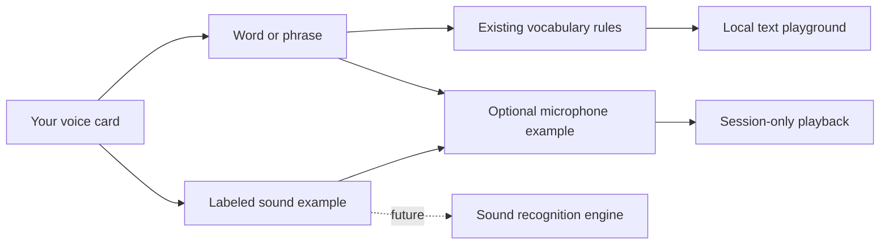

# Your voice · interactive design lab

[Open the working prototype](https://highryzchs.github.io/S2TEasy/voice-lab/).

Vocabulary and Voice Practice currently live in separate desktop tabs. This browser experiment brings them together as **Your voice**: one small library for names, words, phrases, and labeled sound examples. It is a proposed interface to try before migrating the desktop app.

## Try it in a minute

1. Open a sample card or choose **Add something that’s you**.
2. Choose a word, phrase, or sound cue. For a text rule, connect the mistaken transcript to what you want written.
3. Optionally record a short example, stop, and play it back. Save the card.
4. Type the mistaken words in **See the difference**. Enabled word and phrase rules apply immediately. Edit or pause them on their cards.
5. Open **Models & settings** to edit the two model IDs, or **Usage & spend** to try the billing filters. **Reset demo** restores the examples after confirmation.

## What works, and what is a demonstration

| Area                          | This prototype                                                                                                                                               |
| ----------------------------- | ------------------------------------------------------------------------------------------------------------------------------------------------------------ |
| Personal library              | Add, edit, delete, search, filter, and pause cards. Text drafts persist in this browser.                                                                     |
| Text corrections              | The desktop app’s actual whole-word/phrase correction function. No AI or microphone transcription.                                                           |
| Voice examples                | Real local microphone recording, volume meter, and playback; at most 15 seconds per take. Requires a supported browser and permission.                       |
| Sound cues                    | Label and record an example. **No automatic sound-to-word recognition.** A sound label never becomes a text replacement.                                     |
| Model IDs                     | Editable browser preferences, saved locally. No compatibility lookup or paid requests. Desktop settings are unchanged.                                       |
| Analytics                     | Filterable **sample data**, separated into dictation, recovery, and voice cues. Sample dollar amounts are neither current model prices nor account activity. |
| Personal correction assistant | Proposed only; not called or billed.                                                                                                                         |

The animated hero is decorative. Only the recording editor’s waveform responds to microphone volume. Examples do not adapt or retrain a speech model, and practice is not an accent score.

## Privacy and storage

No sign-in, API key, audio upload, speech-recognition service, or paid request is used by this page. Microphone access begins only when you press Record. Stop, cancel, closing the editor, hiding the page, or navigating away releases the microphone; a permission response arriving after dismissal is also cleaned up.

Text cards and model preferences use the browser key `s2teasy-voice-lab-v1`, separate from desktop app data. They remain until you clear browser storage or reset this demo. Up to 100 cards are kept. Do not enter secrets into these example fields.

Recordings stay in the current page’s memory; reloading or leaving discards them. Save keeps an example available for playback during that page session. Closing without saving discards the editor’s new take. There is no audio persistence, export, or training upload. If browser storage is blocked, the page reports that text changes are temporary.

## Where is Gemini in the desktop app?

There are two separate model settings:

- **Speech recognition:** Settings → Speech engine → Audio model slug. This chooses the model that transcribes your words when using OpenRouter.
- **Speech cues:** Settings → Voice intelligence → Audio understanding model. The starting candidate is `google/gemini-2.5-flash-lite`; users can edit its slug. This optional audio-understanding call is separate from speech transcription. Current audio capability, structured output, provider routing, and pricing still need to match the job.

The prototype puts both jobs beside each other so their purpose and editable model IDs are easier to find. A model name alone does not guarantee that its route supports audio.

## Why historical spend can be missing

The desktop app records usage locally from provider responses to its own calls. It does **not** import historical OpenRouter account activity. Calls made before local usage logging, calls from another device, and activity in other clients will not appear automatically. Text transcript history cannot reconstruct a missing provider cost. Missing cost data remains unknown, not zero.

The prototype’s categories describe the work: regular dictation, saved-audio recovery, and optional voice-cue analysis. These are not independent OpenRouter invoices. A future contextual correction feature should have its own category rather than being mixed with transcription. The existing desktop chart currently groups dictation and recovery under Speech to text.

## Code map

- [Prototype interface](../src/renderer/src/voice-lab-main.tsx): unified library, editor, models, and sample billing UI.
- [Draft boundaries and sample fixtures](../src/renderer/src/voice-lab-data.ts): validates browser drafts, keeps sounds out of text rules, distinguishes illustrative costs.
- [Local recorder](../src/renderer/src/VoiceLabRecorder.tsx): bounded recording, live volume, playback, cancellation, and stream cleanup.
- [Working vocabulary engine](../src/shared/vocabulary.ts): the same correction function the desktop app uses.
- [Desktop practice](../src/renderer/src/PracticePanel.tsx) and [progress calculation](../src/shared/practice-progress.ts): current real recognizer practice; deliberately not simulated as model training.
- [Desktop cue settings](../src/renderer/src/CueSettingsPanel.tsx) and [cue model route](../src/main/speech-cue-model.ts): actual optional audio-understanding integration.
- [Desktop usage](../src/renderer/src/UsagePanel.tsx), [usage store](../src/main/usage-store.ts), and [usage aggregation](../src/shared/usage.ts): local provider-reported metrics.

Build with `npm run build:site`, serve `.site/` with a static server, and visit `/voice-lab/`. The prototype has no Electron dependency. It is published with the project website, without changing the desktop app version.
