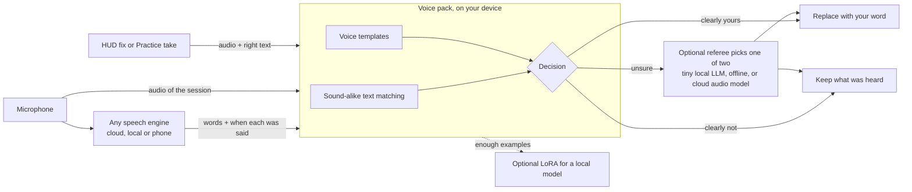

# Voice packs: speech recognition that learns you, on any engine

**Status:** design notes, not shipped. Nothing here is implemented beyond what [Personal words and expressive speech](PERSONAL_SPEECH_DESIGN.md) and the v1.9.0 release notes describe. Numbers are targets to measure, not results.

## The problem

Speech engines are trained on everyone, so they are good at everyone's words and bad at yours. Your name, your friends, your product, your slang and the way your accent bends certain sounds come out as whatever common words sound closest. "Ryzchs" becomes "risks", "S2Teasy" becomes "as two teasy", and for some speakers "bite" becomes "bike".

Most dictation apps answer this with a personal dictionary: a list of words, sometimes sent to the engine as hints, and sometimes an AI pass that tidies the text. That helps, but nothing in it ever hears you. The app never learns what *your* "Ryzchs" sounds like. It only learns that the letters "risks" should be swapped.

S2Teasy already has the ingredient those approaches lack. Every time you click a word on the HUD and fix it, the app has the audio of that moment *and* the text it should have been: a labelled example of your voice, produced as a side effect of normal use. A **voice pack** is what S2Teasy builds from those examples.

## What is new here

The individual techniques are well established (see [Background](#background)): template matching with DTW, sound-alike matching, constrained model checks and LoRA adapters. What S2Teasy puts together, as far as we know for the first time in an open-source dictation app:

- **Corrections are the training data.** Fixing a word on the HUD while you talk records a labelled example of your voice, with no separate enrolment session.
- **The learning sits outside the engine.** The voice pack works with cloud engines that cannot be trained, local models and phone recognizers alike, and moves with you between them.
- **It runs on weak hardware.** Everything except the optional referee and adapter is cheap enough for an old laptop or a phone.
- **Models only break ties.** A tiny local LLM (offline) or a cheap cloud audio model only ever chooses between two candidates, and only for moments the device was unsure about.
- **Claims are measured on your own voice.** Accuracy is reported from your held-out clips, not asserted.

## What "learning your voice" can mean

| Level | What it is | Hears you? | Works with any engine? | Runs on a phone? |
| --- | --- | --- | --- | --- |
| 0. Word list | Replace text the engine wrote ("risks" → Ryzchs) | No | Yes | Yes |
| 1. Engine hints | Tell the engine which words to expect | Indirectly | Only engines that accept hints | Yes |
| 2. Sound-alike text matching | Compare how the written words *sound* with how your words sound | No, but it generalises to forms never seen | Yes | Yes |
| 3. Voice templates | Compare the audio of a moment with recordings of you saying the word | **Yes** | Yes, given word timings | Yes |
| 4. Referee | Pick one of two candidates for an unsure moment: a tiny local LLM from the sentence, or a cloud audio model from the clip | Cloud: yes. Local: no, context only | Yes | Local: yes, offline. Cloud: network call |
| 5. Personal adapter (LoRA) | Train a small add-on for a local speech model on your audio | **Yes, deeply** | No: one adapter per model | Training no; using it maybe |

S2Teasy v1.9.0 ships levels 0 and 1 and a text-only version of 4. A voice pack adds 2 and 3 on every device, 4 with audio, and 5 for people who want it.

## Architecture

The pack sits **between** the engine and your text. It never needs to know which engine produced the words, which is what makes it portable: the same pack works with router.audio, OpenRouter, a local Whisper server, or a phone's built-in recognizer.

## Layer 2: matching by sound, in text

Each personal word gets a pronunciation: a sequence of phonemes. For ordinary spellings a grapheme-to-phoneme table produces it ("Kubernetes" → /k uː b ər n ɛ t iː z/). For words whose spelling misleads, the "sounds like" hint you already type in Your voice is converted instead ("rizz-kss" → /r ɪ z k s/).

When the engine writes a run of one to three words, S2Teasy converts it to phonemes the same way and computes a **weighted phoneme edit distance** to each personal word. Substitutions between sounds that are commonly confused (/b/ and /p/, /θ/ and /s/, /ɪ/ and /iː/) cost less than unrelated ones. Over time the weights can be tuned per user from accepted and rejected fixes: if your "th" is consistently heard as "s", that substitution gets cheaper for you specifically.

What this buys: "rich's", "riz kiss" and "rhizks" all land near /r ɪ z k s/ even though none was ever saved. The word list stops being a list of exact strings and becomes a list of sounds.

What it cannot do: it only sees what the engine wrote. If the engine wrote a word that sounds nothing like what you said, text matching has nothing to go on. That is the job of layer 3.

## Layer 3: voice templates

### What is stored

Not raw audio. A raw waveform of the same word changes completely with microphone, distance, loudness and speed. Each example is turned into a **feature sequence** describing the shape of the sound over time:

- **Classic features:** 13 to 40 log-mel or MFCC coefficients every 10 ms, with per-utterance mean and variance normalisation so loudness and microphone colour mostly cancel out. No neural network, a few kilobytes per example, computable on anything.
- **Learned features (optional):** frames from a small pretrained phonetic encoder (a few MB, ONNX or TFLite), which tolerate noise and accents better. The encoder must model *what was said*, not *who said it*: speaker-identity embeddings are the wrong tool for matching words.

A word's **template set** is its three to eight best examples plus a few **negative examples**: moments where the similar-sounding common word was right ("risks" when you meant risks). Negatives are what stop the pack from turning every "risks" into "Ryzchs".

### Where examples come from

- **HUD fixes.** With word timings from the engine, the moment of the fixed words is known; S2Teasy cuts that span from the session audio with a little padding, extracts features and adds them to the word's templates. Today a fix only stores text and an optional clip reference (`WordClip` in `src/shared/vocabulary.ts`).
- **Practice takes**, where the target is known in advance.
- **Confirmations.** When the pack replaces a word and you leave it, that is weak positive evidence; when you undo it, that moment becomes a negative.

If the engine gives no word timings, S2Teasy does not invent boundaries. Only layer 2 applies.

### Matching

For a candidate moment, S2Teasy extracts the same features and aligns them against each template with **dynamic time warping (DTW)**. DTW stretches and squeezes time so a fast and a slow "Ryzchs" line up, and returns a distance normalised by path length. The best positive distance is compared with the best negative distance and with a per-word threshold.

Thresholds are set per word from your own examples by leave-one-out: each template is scored against the others, and the threshold is placed to accept them while rejecting the negatives. Words with too few examples stay in "suggest only" mode until they have enough.

Cost: a template comparison is a few thousand multiply-adds per frame pair. A sentence with two candidate moments and twenty personal words is well under a millisecond of work on a phone. Only candidate moments are checked (spans that layer 2 flagged, or that sit where a personal word is plausible), never the whole stream against every template.

## Layer 4: the referee

Some moments stay ambiguous: the text and the audio point in different directions, or the word has few examples. Those, and only those, go to a referee. Every referee works under the same contract:

- it gets **exactly two choices**, the heard word and your word, plus the surrounding sentence as data, not instructions;
- it may only **choose one of the two**. It cannot write, add or reword text;
- its answer is validated locally like every other edit, and recorded as evidence for that word;
- it is optional and off by default. With no referee, or none available, an unsure moment is left as heard and underlined on the HUD for you to decide. Accuracy never depends on a referee; it only improves the gray zone.

There are two kinds, and they answer different questions.

### Local referee: a tiny LLM, offline

A small instruction-tuned language model running on the device, with no network. Candidates to evaluate include 0.5 to 1.5 billion parameter models (for example Qwen2.5 0.5B/1.5B Instruct, Llama 3.2 1B Instruct, Gemma 3 1B), quantised to 4 bits (roughly 0.4 to 1 GB) and run through llama.cpp or ONNX Runtime. Output is constrained by a grammar to exactly one of the two choices, so it cannot produce anything else.

It **cannot hear**. It decides from the sentence alone, which makes it right for context cases ("I'll grab a quick bite" vs "I'll ride my bike") and wrong for sound cases, where the sentence fits both words and only the audio can tell ("ask Ryzchs" vs "ask risks"). The decision step therefore only sends it moments where the text context differs between the two choices; sound cases skip it and go to the cloud referee or the HUD.

It costs nothing per use, keeps the sentence on the device and works on a plane. On weak hardware it is optional: a 0.5B model answers a two-choice question in well under a second on a modern CPU, but very old machines and low-end phones may skip it.

### Cloud referee: a small audio model

A small audio-input model (the initial candidate is Gemini 2.5 Flash-Lite through OpenRouter, as in the existing design notes) gets the clip of that moment with a second either side, plus the sentence and the two choices. It **can hear**, so it handles sound cases the local referee cannot. Each call is one bounded request with its own cost line in Usage and the monthly limit, and no clip is sent without the referee being switched on.

### Which referee answers

1. Context case and the local referee is installed: the local referee.
2. Sound case, or no local referee, and the cloud referee is on: the cloud referee.
3. Otherwise: the HUD underlines the word and you choose. Your choice becomes a template or a negative, so the same moment is less likely to be unsure next time.

## The decision

Each candidate moment gets three numbers: the text distance (layer 2), the voice distance (layer 3) and a prior from the word's history (how often it was right before, and how often it was undone). A small, fixed scoring rule combines them into one of three outcomes:

- **replace**: both layers agree, or the voice match is strong and the word is well established;
- **keep**: the voice clearly matches a negative, or neither layer is close;
- **unsure**: anything else; it goes to a referee (layer 4) or to the HUD.

The rule is deliberately simple and inspectable rather than learned, so every replacement can be explained: "replaced because it sounded like your 4 recordings of Ryzchs and not like 'risks'".

## Layer 5: personal adapters (LoRA)

A LoRA is a small set of extra weights (a few MB) trained on top of a frozen speech model. It does not need a chat LLM: it trains the speech model itself, on pairs of your audio and the correct text, which the voice pack has already collected.

Facts that shape how it fits:

- **An adapter belongs to one model.** A LoRA trained for one Whisper size does not work with another, nor with any cloud engine. It is an upgrade for the local engine, not a replacement for the voice pack.
- **Training needs a GPU,** or a paid cloud run the user starts explicitly. Running the adapted model is feasible on desktops; on phones it depends on the model size.
- **It changes how the engine hears everything,** not just listed words: vowels, pace, and words you never corrected. This is the only layer that can improve an accent in general.
- **Data before training.** Expect tens of minutes of corrected audio before an adapter is worth measuring. Every adapter is evaluated against held-out clips before it is switched on, and kept only if it helps.

The voice pack keeps running on top of an adapted engine. The two do different jobs.

## Portability: one pack, every device

A voice pack is a versioned file:

- personal words with pronunciations and hints (already in settings),
- per-word template sets: feature sequences, the extractor name and version, sample rate, and whether each example is positive or negative,
- per-user substitution weights and per-word thresholds,
- no raw audio, no transcripts, no keys.

Because it is engine-agnostic, a pack built on a desktop can be exported to a phone and work there on day one. Features from different extractor versions are never mixed; a version change re-extracts from retained audio or asks for new examples.

## Privacy

Voice templates are derived from your voice and count as voice data:

- built only with an explicit opt-in, separate from recovery audio;
- stored on the device, never uploaded except a referee clip you allowed, or an adapter training run you started;
- listed, viewable and deletable per word, and deleted together with the word;
- excluded from exports unless you include them on purpose.

Classic features can be partly turned back into rough audio, so they are protected like audio, not like text.

## How it will be measured

Before claiming "learns your voice", every layer is scored on your own held-out clips (Practice takes and HUD fixes not used for training):

- **personal word accuracy:** your listed words come out right, before and after;
- **false replacement rate:** a common word wrongly turned into one of yours. This matters most, and must stay near zero;
- **word error rate** over whole held-out sentences, to catch regressions;
- **referee rate and cost:** how often layer 4 is needed.

The app will show these numbers to the user, from their own data, instead of a progress bar.

## Open questions

- Which phonetic encoder is small enough for phones and good enough on accented speech; the classic features are the baseline it has to beat.
- How many templates per word are needed in practice, by word length.
- How to collect negatives without asking the user to do work.
- Word timings: which engines provide them reliably during streaming, and how accurate they are at word edges.
- Languages beyond English need their own phoneme tables.
- Which tiny local LLM gives the best two-choice accuracy per megabyte, and whether it is worth shipping by default or as an optional download.
- How reliably the decision step can tell context cases from sound cases.

## Plan

1. **Link each HUD fix to its moment of audio** and keep it in the word's history (opt-in).
2. **Sound-alike text matching** with your hints as pronunciations.
3. **Classic voice templates** with DTW, per-word thresholds and negatives, in suggest-only mode first.
4. **A personal accuracy report** built from your own held-out clips.
5. **Referees** for unsure moments: the tiny local LLM for context cases, then the cloud audio model for sound cases.
6. **Voice pack export and import**, then mobile.
7. **Optional local Whisper engine with personal adapters.**

## Background

- Sakoe and Chiba, *Dynamic programming algorithm optimization for spoken word recognition*, 1978 (DTW).
- Davis and Mermelstein, *Comparison of parametric representations for monosyllabic word recognition*, 1980 (MFCC).
- Hazen, Shen and White, *Query-by-example spoken term detection using phonetic posteriorgram templates*, 2009.
- Hu et al., *LoRA: Low-rank adaptation of large language models*, 2021.
- Radford et al., *Robust speech recognition via large-scale weak supervision*, 2022 (Whisper).
